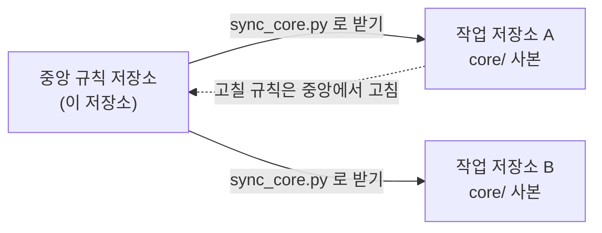

# rsj-centralized-control

AI(Claude Code · Codex)와 함께 작업하는 여러 저장소에, **같은 작업 규칙을 한 곳에서 나눠 주는 중앙 규칙 저장소**입니다.

규칙은 이 저장소에서만 고치고, 각 작업 저장소는 `core/` 폴더를 받아서 씁니다. 받은 저장소의 `CLAUDE.md` · `AGENTS.md`가 그 규칙을 가리키도록 만들어지기 때문에, AI는 작업을 시작할 때 필요한 규칙만 골라 읽습니다.

## 왜 만들었나요

게임 기획서, 프로그램 개발, 언리얼 엔진 공부, QA 테스트, 앱 기획, 발표 자료까지 성격이 다른 일을 저장소 여러 개에서 AI와 함께 진행하고 있습니다.

일하다 보면 "이 부분은 이렇게 쓰자", "이건 하지 말자" 같은 규칙이 계속 생깁니다. 그런데 한 저장소에서 고친 규칙은 다른 저장소에 전해지지 않았고, 새 저장소를 열 때마다 AI에게 같은 설명을 처음부터 다시 해야 했습니다. 결과물의 모양도 저장소마다 조금씩 달라졌습니다.

그래서 모든 저장소가 따르는 규칙은 한 곳에 모으고, 각 저장소는 그것을 받아 가도록 나눴습니다. 자세한 이야기는 [블로그 소개글](https://ryuseojin.com/github-rsj-centralized-control)에 있습니다.

## 어떻게 돌아가나요



중앙 규칙은 두 종류로 나뉩니다.

| | `core/base` | `core/modules` |
|---|---|---|
| 무엇인가 | 어떤 저장소든 항상 따르는 기본 규칙과 도구 | 한 가지 일을 위한 규칙 · 서식 · 도구 묶음 |
| 적용 | 받으면 전부 적용됩니다 | 프로젝트마다 필요한 것만 켭니다. 켜지 않은 모듈은 AI가 읽지 않습니다 |
| 예 | 작업 전에 읽을 것, 요청 범위, 문서 문체, 변경 이력, git 규칙 | 테스트 케이스(`tc`), 앱 기획 슬라이드(`app-planning-slides`), 언리얼 빌드(`ue-build`) |

규칙이 언제 왜 바뀌었는지는 [center-change-log.md](center-change-log.md)에 남고, 받아 가는 쪽이 할 일이 「태그」로 함께 적힙니다.

## 내 중앙 규칙 저장소로 쓰기

이 저장소를 그대로 받아 써도 되고, fork해서 내 규칙으로 바꿔 써도 됩니다.

1. **fork합니다.** 비공개로 쓰고 싶다면 fork 대신 새 비공개 저장소를 만들고 이 저장소 내용을 복사해 올립니다. 공개 저장소의 fork는 공개이기 때문입니다.
2. **이름표를 바꿉니다.** 루트의 `workspace.json`에서 `name` · `repo` · `visibility`를 내 저장소에 맞게 고칩니다.
3. **규칙을 고칩니다.** 기본 규칙은 `core/base/rules/`에, 모듈은 `core/modules/{모듈}/`에 있습니다. 모듈을 새로 만드는 방법은 `core/base/rules/feature-request.md`에 정리되어 있습니다.
4. **검사합니다.** 커밋 전에 아래를 돌립니다. 이 README의 규칙 목록과 모듈 목록도 이때 다시 만들어집니다.

   ```bash
   python core/base/scripts/regen.py
   python core/base/scripts/check_rules.py
   python -m unittest discover -s core/base/scripts -p "test_*.py"
   ```
5. **작업 저장소에서 받습니다.** 아래 「작업 저장소에서 쓰기」의 `--from` 주소를 내 저장소 주소로 바꿔 쓰면 됩니다.

> 작업 저장소는 이 저장소를 fork해서 만들지 않습니다. 새 저장소를 만들고 `core/`만 받아 옵니다. 그래야 작업 내용이 중앙 저장소로 섞여 들어가지 않습니다.

## 작업 저장소에서 쓰기

### 처음 받기

받을 저장소 루트에 이름표 파일 `workspace.json`을 두고 받습니다. 이름표 모양은 `core/base/rules/site-structure.md` §3에 있습니다.

```bash
python {이 저장소를 받은 위치}/core/base/scripts/sync_core.py --from https://github.com/RyuSeoJin/rsj-centralized-control --repo-root {받을 저장소}
```

받은 뒤 진입점과 저장소 이력을 둡니다. 빈 서식은 `core/base/design-template/repo/`에 있습니다. 그다음 읽기 규칙을 만들고 검사합니다.

```bash
python core/base/scripts/regen.py
python core/base/scripts/check_rules.py
```

이미 있는 폴더는 옮기지 않고 프로젝트로 등록만 합니다. 옮기면 링크와 참조가 깨지기 때문입니다(`core/base/rules/project-scaffold.md` §5).

### 프로젝트를 만들고 모듈 켜기

```bash
python core/base/scripts/new_project.py {프로젝트}          # 관리 파일을 가진 새 프로젝트
python core/base/scripts/module.py list {프로젝트}          # 켤 수 있는 모듈과 켜짐 상태
python core/base/scripts/module.py on {프로젝트} {모듈}     # 켜기 (off 로 끄기)
```

모듈은 그 프로젝트에만 적용됩니다. 먼저 켜야 하는 모듈이 꺼져 있으면 도구가 멈추고 켤 순서를 알려 줍니다. 어떤 모듈이 맞는지는 아래 「모듈 목록」이나 [모듈 지도](core/modules/module-map.md)에서 찾을 수 있습니다.

### 규칙이 바뀌면 다시 받기

```bash
python core/base/scripts/sync_core.py --from https://github.com/RyuSeoJin/rsj-centralized-control --check
python core/base/scripts/sync_core.py --from https://github.com/RyuSeoJin/rsj-centralized-control
```

`--check`로 무엇이 바뀌는지 먼저 보고 받습니다. 받은 뒤에는 `center-change-log.md`의 새 항목에 적힌 태그를 처리하고 `regen.py` · `check_rules.py`를 다시 돌립니다(`core/base/rules/central-sync.md` §2).

### AI에게 맡길 때

작업 저장소에서 세션을 열고 이 저장소 폴더를 함께 추가한 뒤, 이렇게 요청하면 위 순서대로 진행합니다.

> 이 저장소에 중앙 규칙을 처음 받아 주세요. 중앙 규칙 폴더는 `../rsj-centralized-control`입니다. 기존 폴더는 옮기지 말고 프로젝트로 등록해 주세요.

## 중앙 규칙을 고치고 싶을 때

작업 저장소에서 `core/`를 직접 고치지 않습니다. 고친 파일이 있으면 다음에 받을 때 도구가 멈추고, 덮어쓰면 그 수정이 사라집니다.

대신 이 저장소를 작업 저장소 옆에 받아 두고 함께 엽니다. 고칠 곳을 발견하면 이 저장소에서 바로 고치고, 작업 저장소는 다시 받습니다. 이때 특정 프로젝트의 이름이나 값은 빼고 적습니다. "문장에서 프로젝트 이름을 지워도 말이 되는가"가 중앙 규칙과 프로젝트 규칙을 가르는 기준입니다(`core/base/rules/site-structure.md` §2).

```
{작업 폴더}/
├─ rsj-centralized-control/   ← 공개 · 규칙 정본
├─ {작업 저장소 A}/            ← 비공개 · core/ 사본 + 작업물
└─ {작업 저장소 B}/
```

프로젝트 파일이 중앙 저장소에 섞여 들어오면 GitHub Actions(`.github/workflows/central-gate.yml`)가 막습니다. 이 저장소에서 일할 때의 절차는 [CLAUDE.md](CLAUDE.md)에 있습니다.

## 들어 있는 것

| 자리 | 내용 |
|---|---|
| `core/base/` | 기본 규칙(`rules/`), 문서 제작 절차, 용어집, 디자인 마스터, 빈 서식, 도구(`scripts/`) |
| `core/modules/` | 골라 켜는 모듈. 모듈마다 `module.md`가 자기소개입니다 |
| `center-change-log.md` | 중앙 규칙의 변경 이력과 받는 쪽이 할 일 |
| `center-remaining-work.md` | 남은 일과 결정 대기 |
| `center-tool-specs/` | 규칙은 있지만 아직 도구가 없는 것의 구현 명세 |

## base 규칙 목록

아래 표는 `core/base/base-groups.json`과 각 규칙 문서에서 `regen.py`가 만듭니다. 직접 고치지 않습니다.

<!-- base-overview:start — 생성물입니다. 손으로 고치지 않습니다(gen_base_map.py --readme) -->

규칙마다 주요 절 · 가리키는 규칙 · 분야별 관계 그림은 [base 규칙 지도](core/base/base-map.md)에 있습니다.

| 분야 | 규칙 | 내용 | 언제 읽나 |
|---|---|---|---|
| 작업을 시작하고 범위를 정할 때 | [read-gates](core/base/rules/read-gates.md) | 작업 전에 무엇을 읽는가 | 모든 작업 — 무엇을 더 읽을지 정합니다 |
|  | [change-scope](core/base/rules/change-scope.md) | 요청받은 범위 밖을 고치지 않는 규칙 | 모든 작업 |
|  | [rule-conflict](core/base/rules/rule-conflict.md) | 규칙이 어긋날 때 무엇을 기준으로 고르는가 | 규칙끼리 어긋날 때 |
|  | [feature-request](core/base/rules/feature-request.md) | 「이 기능을 넣고 싶다」가 나왔을 때 무엇부터 보는가 | 「이 기능(규칙 · 서식 · 도구)을 넣고 싶다」 |
|  | [agent-delegation](core/base/rules/agent-delegation.md) | 일을 여러 에이전트에 나눠 맡길 때의 규칙 | 일을 여러 에이전트에 나눠 맡길 때 |
| 문서를 만들 때 | [doc-playbook](core/base/doc-playbook.md) | 문서 제작 요청을 받았을 때 처음부터 끝까지 따르는 절차 | 문서 제작 (설명 · 분석 · 설계 · 기획서) |
|  | [writing-principles](core/base/rules/writing-principles.md) | 처음 보는 사람도 혼자 읽고 따라 할 수 있게 쓰는 법 | 문서 제작 (설명 · 분석 · 설계 · 기획서) |
|  | [doc-write-style](core/base/rules/doc-write-style.md) | 문체와 문장 구조를 정하는 문서 | 문서를 쓰거나 고칠 때 |
|  | [html-output](core/base/rules/html-output.md) | HTML 산출물을 한 파일로 완결되게 내보내는 규칙 | HTML 산출물을 만들 때 |
|  | [code-example](core/base/rules/code-example.md) | 코드를 보여 줄 때 파일 자리 · 주석 · 설명을 어떻게 쓰는가 | 코드를 보여 주거나 예제 코드를 쓸 때 (채팅 포함) |
|  | [flowchart](core/base/rules/flowchart.md) | 흐름을 도형과 선으로 그릴 때 | 흐름도 · 순서도 · 화면 이동 지도를 도형으로 그릴 때 (도구 · 매체 무관) |
| 정본과 기록을 다룰 때 | [canonical-source](core/base/rules/canonical-source.md) | 책임 범위별 정본과 파생물을 관리하는 규칙 | 사양 · 구현 · 파생물을 만들거나 고칠 때 |
|  | [change-log-writing](core/base/rules/change-log-writing.md) | 변경 이력을 어디에 어떤 모양으로 남기는가 | change-log에 항목을 쓸 때 |
|  | [remaining-work](core/base/rules/remaining-work.md) | 앞으로 할 일을 대화가 아니라 파일에 남기는 규칙 | — |
|  | [completion-evidence](core/base/rules/completion-evidence.md) | 무엇으로 「완료」를 증명했는가 | 작업 완료를 보고하거나 검증 결과를 기록할 때 |
|  | [external-material](core/base/rules/external-material.md) | 외부 자료를 들여오고 외부 도구에 자료를 보낼 때 | 외부 도구의 자료를 반입하거나 외부 AI에 자료 묶음을 보낼 때 |
| 저장소 · 프로젝트를 꾸릴 때 | [site-structure](core/base/rules/site-structure.md) | 무엇을 어디에 두고, 중앙과 프로젝트를 어떻게 가르는가 | — |
|  | [project-scaffold](core/base/rules/project-scaffold.md) | 새 프로젝트가 무엇을 갖고 시작하고, 옛 폴더는 어떻게 등록하는가 | 새 프로젝트를 시작하거나 옛 폴더를 등록할 때 |
|  | [central-sync](core/base/rules/central-sync.md) | 중앙 저장소에서 규칙을 받아 가고 되돌려 보내는 절차 | 중앙 규칙을 받거나 되돌려 보낼 때 |
|  | [git-rules](core/base/rules/git-rules.md) | 커밋 · push · 브랜치 · 버전 태그 규칙 | 작업 단위 하나가 끝났을 때 / 커밋 · push |
| 용어를 찾을 때 | [dictionary](core/base/dictionary.md) | 중앙 용어집 (색인) | — |

<!-- base-overview:end -->

## 모듈 목록

아래 표는 각 모듈의 `module.json` · `module.md`에서 `regen.py`가 만듭니다. 직접 고치지 않습니다.

<!-- module-overview:start — 생성물입니다. 손으로 고치지 않습니다(gen_module_map.py --readme) -->

분야별 연결 그림 · 함께 쓰는 짝 · 고르는 기준 · 외부 도구의 용도는 [모듈 지도](core/modules/module-map.md)에 있습니다. (선택)은 일부 기능에만 필요한 외부 도구입니다.

| 분야 | 모듈 | 하는 일 | 외부 도구 |
|---|---|---|---|
| QA · 검증 | `tc` | 테스트 케이스를 설계하고 시트로 냅니다 | openpyxl |
|  | `automation` | TC를 사람이 아니라 코드가 돌립니다 | — |
|  | `sut` | 검증 대상을 직접 만들고 결함을 심어 탐지력을 봅니다 | — |
|  | `llm` | 출력을 생성하는 기능을 무엇으로 검증하는가 | — |
| 기획 문서 | `planning-spec` | 기능 골격과 상세 사양으로 기획 정본을 작성합니다 | — |
|  | `app-planning-slides` | 앱 기획 문서를 프롬프트로 채워 Google Slides로 냅니다 | python-pptx, Google Slides(선택) |
|  | `gdd` | 코드 전에 시스템 하나를 합의하는 기획서를 쓰고, 프로토타입으로 확인합니다 | — |
|  | `ui-terms` | 화면 부품을 같은 이름으로 부르는 UI 용어집 | — |
| 문서 외형 · 사이트 | `document-site` (워크스페이스) | 공통 HTML 디자인과 문서 탐색을 제공합니다 | — |
|  | `qa-site` (워크스페이스) | QA 분석 서식과 메뉴를 공통 문서 사이트에 더합니다 | — |
|  | `html-design-kit` | 자기완결 HTML 문서를 조립하는 공용 디자인 킷 | — |
| 앱 체험 · 프로토타입 | `app-preview` | 가상 화면에서 앱 플로우를 비교하는 체험 도구 | Node.js(선택), Playwright(선택) |
|  | `app-simulator` | 앱 프로토타입을 기기 틀 안에서 돌리는 시뮬레이터 | Node.js(선택), Chrome · Edge(선택) |
|  | `app-wireframe` | 시뮬레이터를 키트 기반 Figma 와이어프레임으로 정리합니다 | Figma, Figma MCP · 스킬 |
|  | `workflow-explorer` | 앱 워크플로우를 조작하며 따라가는 탐색기 | Playwright(선택), Pillow(선택), Microsoft Edge(선택) |
| 화면 설계 | `penpot-ux` | Penpot으로 화면 흐름도 · 와이어프레임 · 공통 컴포넌트를 설계합니다 | Penpot |
| 게임 프로토타입 | `game-html` | 게임 화면과 규칙을 한 파일 HTML로 만들어 직접 플레이하며 검토합니다 | — |
| 게임 · UE | `ue-build` | UE C++ 프로젝트를 명령으로 빌드하고 게임 창을 직접 조작해 점검합니다 | Unreal Engine |
|  | `ue-doc` | 언리얼 엔진 문서를 지식 위키와 프로젝트 문서로 나눠 씁니다 | — |
|  | `ue-localization` | 번역을 시트에서 관리하고 UE 표준 번역 파일로 넣습니다 | Unreal Engine, 스프레드시트 |
|  | `ue-umg` | UMG 화면을 위젯 블루프린트 대신 C++ 코드로 만들 때의 함정을 피합니다 | Unreal Engine |
| 아트 | `app-asset` | 앱 UI 에셋을 제작하고 한 벌로 관리합니다 | 이미지 생성 도구(선택) |
|  | `pixel-art` | 픽셀 아트 그림을 같은 규칙으로 만들고 화면에 매끄럽게 올립니다 | Pillow, Aseprite(선택), Spine(선택) |
| 역분석 | `reverse-analysis` | 출시된 게임 · 앱 · 웹을 소스 없이 분석하고, 근거와 함께 기록합니다 | REA |
| AI 에이전트 협업 | `agent-office` | AI 에이전트들이 나눠 하는 일을 로컬 사무실 화면에서 지켜봅니다 | AI 사무실 앱, Node.js, Claude Code(선택) |
| 컴퓨터 환경 | `android-emulator` (호스트) | Android Emulator 환경을 재현 가능하게 관리합니다 | Android Studio · SDK · Emulator |
|  | `aseprite` (호스트) | 이 컴퓨터에서 Aseprite를 배치 모드로 돌리고 MCP로 연결하는 환경을 점검합니다 | Aseprite, aseprite MCP 서버(선택) |
|  | `rea` (호스트) | 이 컴퓨터에 REA(역분석 MCP 서버)를 설치하고 연결 상태를 점검합니다 | REA, Node.js, Ghidra · Hopper · IDA(선택) |

### 밖에서 끌어다 쓰는 도구

모듈이 쓰는 웹 서비스 · 설치 프로그램 · MCP 서버 · 라이브러리입니다. 정본은 각 모듈의 `module.json` `external`입니다.

| 외부 도구 | 종류 | 쓰는 모듈 |
|---|---|---|
| AI 사무실 앱 | 설치 프로그램 | `agent-office` |
| Android Studio · SDK · Emulator | 설치 프로그램 | `android-emulator` |
| Aseprite | 설치 프로그램 | `pixel-art`(선택), `aseprite` |
| aseprite MCP 서버 | MCP 서버 | `aseprite`(선택) |
| Chrome · Edge | 설치 프로그램 | `app-simulator`(선택) |
| Claude Code | 설치 프로그램 | `agent-office`(선택) |
| Figma | 웹 서비스 | `app-wireframe` |
| Figma MCP · 스킬 | MCP 서버 | `app-wireframe` |
| Ghidra · Hopper · IDA | 설치 프로그램 | `rea`(선택) |
| Google Slides | 웹 서비스 | `app-planning-slides`(선택) |
| Microsoft Edge | 설치 프로그램 | `workflow-explorer`(선택) |
| Node.js | 실행 환경 | `app-preview`(선택), `app-simulator`(선택), `agent-office`, `rea` |
| openpyxl | 라이브러리 | `tc` |
| Penpot | 웹 서비스 | `penpot-ux` |
| Pillow | 라이브러리 | `workflow-explorer`(선택), `pixel-art` |
| Playwright | 라이브러리 | `app-preview`(선택), `workflow-explorer`(선택) |
| python-pptx | 라이브러리 | `app-planning-slides` |
| REA | MCP 서버 | `reverse-analysis`, `rea` |
| Spine | 설치 프로그램 | `pixel-art`(선택) |
| Unreal Engine | 설치 프로그램 | `ue-build`, `ue-localization`, `ue-umg` |
| 스프레드시트 | 웹 서비스 | `ue-localization` |
| 이미지 생성 도구 | 웹 서비스 | `app-asset`(선택) |

<!-- module-overview:end -->

## 기여

규칙이 이상하거나 더 나은 방법이 있다면 [Issues](https://github.com/RyuSeoJin/rsj-centralized-control/issues)에 남겨 주세요. PR도 환영합니다. PR을 올리면 중앙 검사(`central-gate`)가 돌고, 프로젝트 파일이 섞여 있으면 합쳐지지 않습니다.

## 라이선스

[MIT](LICENSE) © 2026 Ryu Seo Jin
