# central-rules — 여러 저장소가 함께 쓰는 중앙 규칙 저장소

여러 작업 저장소가 **같은 규칙으로 문서를 만들고 운영되도록**, 그 규칙을 한 곳에 모아 두고 나눠 주는
저장소입니다. 규칙은 이 저장소에서만 고치고, 각 작업 저장소는 `core/`를 받아 씁니다.

## 한눈에 보기

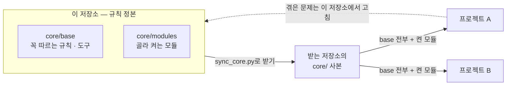

- **base**는 모든 저장소 · 프로젝트가 따릅니다. 작업마다 무엇을 읽을지는 [읽기 게이트](core/base/rules/read-gates.md)가 정합니다.
- **모듈**은 프로젝트마다 골라 켭니다. 켜지 않은 모듈은 AI가 읽지 않습니다. 아래 「모듈 한눈에」에 분야별 목록과 연결 그림 · 외부 도구가 있습니다.
- 규칙이 언제 · 왜 바뀌었는지와 받아 가는 쪽이 할 일은 [center-change-log.md](center-change-log.md)에 있습니다.

## 왜 만들었나

게임 기획서 · 프로그램 개발 · 언리얼 엔진 공부 · QA 테스트 · 앱 기획 · 발표 자료처럼 성격이 다른
프로젝트를 AI(Claude Code · Codex)와 함께 진행하다 보면 두 가지 문제가 생깁니다.

- 한 프로젝트에서 겪은 일로 규칙을 고쳐도, 다른 저장소에는 예전 규칙이 그대로 남습니다.
- 새 프로젝트마다 같은 설명을 다시 해야 하고, 결과물의 모양이 들쭉날쭉해집니다.

그래서 「모든 저장소가 따르는 규칙」은 이 저장소 한 곳에서만 고치고, 작업 저장소는 그것을 받아 쓰도록
나눴습니다.

## 무엇이 들어 있나

| 자리 | 내용 |
|---|---|
| `core/base/` | 꼭 따르는 기본 규칙(아래 「base 규칙」) · 디자인 마스터 · 빈 서식 · 검사와 받기 도구 |
| `core/modules/` | 필요한 프로젝트만 골라 켜는 모듈. 켜면 그 모듈의 규칙 · 서식 · 도구가 따라옵니다 |
| `center-change-log.md` | 중앙 규칙의 변경 이력과, 받아 가는 쪽이 할 일(태그) |
| `center-remaining-work.md` | 중앙 규칙에 남은 일 · 사용자 결정 대기 · 백로그 |
| `center-tool-specs/` | 규칙은 있지만 도구가 아직 없는 것의 구현 명세 |

## base 규칙 — 하는 일별

아래 구역은 `core/base/base-groups.json`(분류)과 각 규칙 문서 · 읽기 게이트에서 `regen.py`가 다시 만듭니다.
손으로 고치지 않습니다. 「언제 읽나」는 읽기 게이트에 적힌 상황이며, 비어 있는 규칙은 다른 규칙을 거쳐 읽힙니다.

<!-- base-overview:start — 생성물입니다. 손으로 고치지 않습니다(gen_base_map.py --readme) -->

규칙마다 주요 절 · 가리키는 규칙 · 분야별 관계 그림은 [base 규칙 지도](core/base/base-map.md)에 있습니다.

| 분야 | 규칙 | 내용 | 언제 읽나 |
|---|---|---|---|
| 작업을 시작하고 범위를 정할 때 | [read-gates](core/base/rules/read-gates.md) | 작업 전에 무엇을 읽는가 | 모든 작업 — 무엇을 더 읽을지 정합니다 |
|  | [change-scope](core/base/rules/change-scope.md) | 요청받은 범위 밖을 고치지 않는 규칙 | 모든 작업 |
|  | [rule-conflict](core/base/rules/rule-conflict.md) | 규칙이 어긋날 때 무엇을 기준으로 고르는가 | 규칙끼리 어긋날 때 |
|  | [feature-request](core/base/rules/feature-request.md) | 「이 기능을 넣고 싶다」가 나왔을 때 무엇부터 보는가 | 「이 기능(규칙 · 서식 · 도구)을 넣고 싶다」 |
|  | [agent-delegation](core/base/rules/agent-delegation.md) | 일을 여러 에이전트에 나눠 맡길 때의 규칙 | 일을 여러 에이전트에 나눠 맡길 때 |
| 문서를 만들 때 | [doc-playbook](core/base/doc-playbook.md) | 문서 제작 요청을 받았을 때 처음부터 끝까지 따르는 절차 | 문서 제작 (설명 · 분석 · 설계 · 기획서) |
|  | [writing-principles](core/base/rules/writing-principles.md) | 처음 보는 사람도 혼자 읽고 따라 할 수 있게 쓰는 법 | 문서 제작 (설명 · 분석 · 설계 · 기획서) |
|  | [doc-write-style](core/base/rules/doc-write-style.md) | 문체와 문장 구조를 정하는 문서 | 문서를 쓰거나 고칠 때 |
|  | [html-output](core/base/rules/html-output.md) | HTML 산출물을 한 파일로 완결되게 내보내는 규칙 | HTML 산출물을 만들 때 |
|  | [code-example](core/base/rules/code-example.md) | 코드를 보여 줄 때 파일 자리 · 주석 · 설명을 어떻게 쓰는가 | 코드를 보여 주거나 예제 코드를 쓸 때 (채팅 포함) |
|  | [flowchart](core/base/rules/flowchart.md) | 흐름을 도형과 선으로 그릴 때 | 흐름도 · 순서도 · 화면 이동 지도를 도형으로 그릴 때 (도구 · 매체 무관) |
| 정본과 기록을 다룰 때 | [canonical-source](core/base/rules/canonical-source.md) | 책임 범위별 정본과 파생물을 관리하는 규칙 | 사양 · 구현 · 파생물을 만들거나 고칠 때 |
|  | [change-log-writing](core/base/rules/change-log-writing.md) | 변경 이력을 어디에 어떤 모양으로 남기는가 | change-log에 항목을 쓸 때 |
|  | [remaining-work](core/base/rules/remaining-work.md) | 앞으로 할 일을 대화가 아니라 파일에 남기는 규칙 | — |
|  | [completion-evidence](core/base/rules/completion-evidence.md) | 무엇으로 「완료」를 증명했는가 | 작업 완료를 보고하거나 검증 결과를 기록할 때 |
|  | [external-material](core/base/rules/external-material.md) | 외부 자료를 들여오고 외부 도구에 자료를 보낼 때 | 외부 도구의 자료를 반입하거나 외부 AI에 자료 묶음을 보낼 때 |
| 저장소 · 프로젝트를 꾸릴 때 | [site-structure](core/base/rules/site-structure.md) | 무엇을 어디에 두고, 중앙과 프로젝트를 어떻게 가르는가 | — |
|  | [project-scaffold](core/base/rules/project-scaffold.md) | 새 프로젝트가 무엇을 갖고 시작하고, 옛 폴더는 어떻게 등록하는가 | 새 프로젝트를 시작하거나 옛 폴더를 등록할 때 |
|  | [central-sync](core/base/rules/central-sync.md) | 중앙 저장소에서 규칙을 받아 가고 되돌려 보내는 절차 | 중앙 규칙을 받거나 되돌려 보낼 때 |
|  | [git-rules](core/base/rules/git-rules.md) | 커밋 · push · 브랜치 · 버전 태그 규칙 | 작업 단위 하나가 끝났을 때 / 커밋 · push |
| 용어를 찾을 때 | [dictionary](core/base/dictionary.md) | 중앙 용어집 (색인) | — |

<!-- base-overview:end -->

## 모듈 한눈에

아래 구역은 각 모듈의 `module.json` · `module.md`에서 `regen.py`가 다시 만듭니다. 손으로 고치지 않습니다.

<!-- module-overview:start — 생성물입니다. 손으로 고치지 않습니다(gen_module_map.py --readme) -->

그림에서 `A --> B`는 B를 켜려면 A가 먼저 켜져 있어야 한다는 뜻(전제)입니다. 점선은 함께 켜면 더 잘 맞는 짝, 양쪽 화살표 점선은 하는 일이 겹쳐 보통 하나만 켜는 짝입니다. 회색 점선 상자는 다른 분야의 모듈입니다. (선택)은 그 모듈의 일부 기능에만 필요한 외부 도구입니다. 고르는 기준은 [모듈 지도](core/modules/module-map.md)에 있습니다.

### QA · 검증

**만든 것을 테스트 케이스로 검증하나요?**

| 모듈 | 하는 일 | 외부 도구 |
|---|---|---|
| `tc` | 테스트 케이스를 설계하고 시트로 냅니다 | openpyxl |
| `automation` | TC를 사람이 아니라 코드가 돌립니다 | — |
| `sut` | 검증 대상을 직접 만들고 결함을 심어 탐지력을 봅니다 | — |
| `llm` | 출력을 생성하는 기능을 무엇으로 검증하는가 | — |

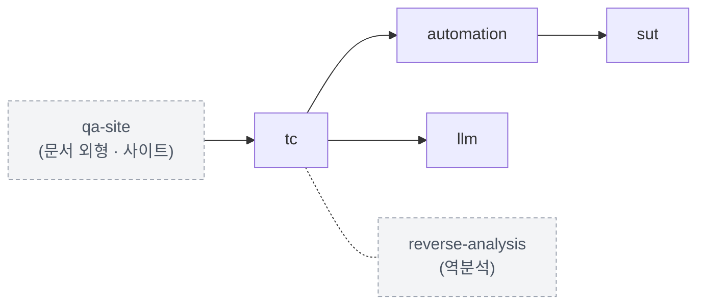

### 기획 문서

**구현 전에 기획을 문서로 합의 · 공유하나요?**

| 모듈 | 하는 일 | 외부 도구 |
|---|---|---|
| `planning-spec` | 기능 골격과 상세 사양으로 기획 정본을 작성합니다 | — |
| `app-planning-slides` | 앱 기획 문서를 프롬프트로 채워 Google Slides로 냅니다 | python-pptx, Google Slides(선택) |
| `gdd` | 코드 전에 시스템 하나를 합의하는 기획서를 쓰고, 프로토타입으로 확인합니다 | — |
| `ui-terms` | 화면 부품을 같은 이름으로 부르는 UI 용어집 | — |

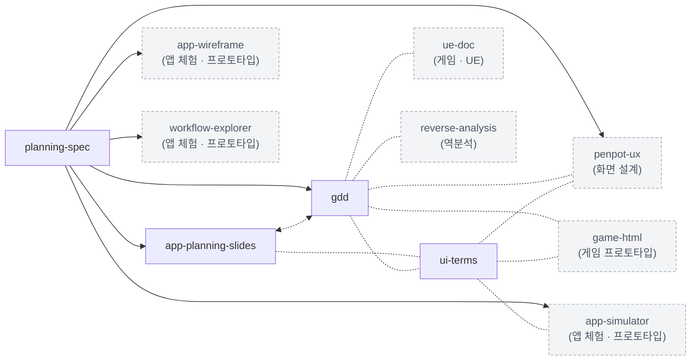

### 문서 외형 · 사이트

**문서를 한 사이트나 공용 디자인으로 묶어 내나요?**

| 모듈 | 하는 일 | 외부 도구 |
|---|---|---|
| `document-site` (워크스페이스) | 공통 HTML 디자인과 문서 탐색을 제공합니다 | — |
| `qa-site` (워크스페이스) | QA 분석 서식과 메뉴를 공통 문서 사이트에 더합니다 | — |
| `html-design-kit` | 자기완결 HTML 문서를 조립하는 공용 디자인 킷 | — |

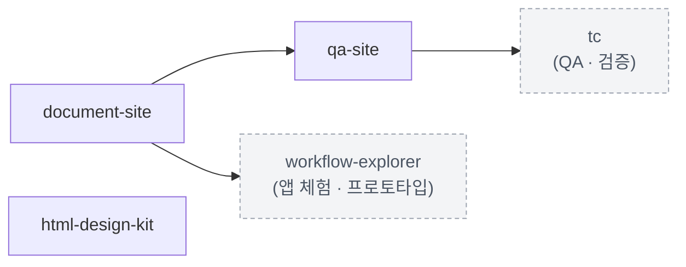

### 앱 체험 · 프로토타입

**앱 화면과 흐름을 직접 눌러 보며 검토하나요?**

| 모듈 | 하는 일 | 외부 도구 |
|---|---|---|
| `app-preview` | 가상 화면에서 앱 플로우를 비교하는 체험 도구 | Node.js(선택), Playwright(선택) |
| `app-simulator` | 앱 프로토타입을 기기 틀 안에서 돌리는 시뮬레이터 | Node.js(선택), Chrome · Edge(선택) |
| `app-wireframe` | 시뮬레이터를 키트 기반 Figma 와이어프레임으로 정리합니다 | Figma, Figma MCP · 스킬 |
| `workflow-explorer` | 앱 워크플로우를 조작하며 따라가는 탐색기 | Playwright(선택), Pillow(선택), Microsoft Edge(선택) |

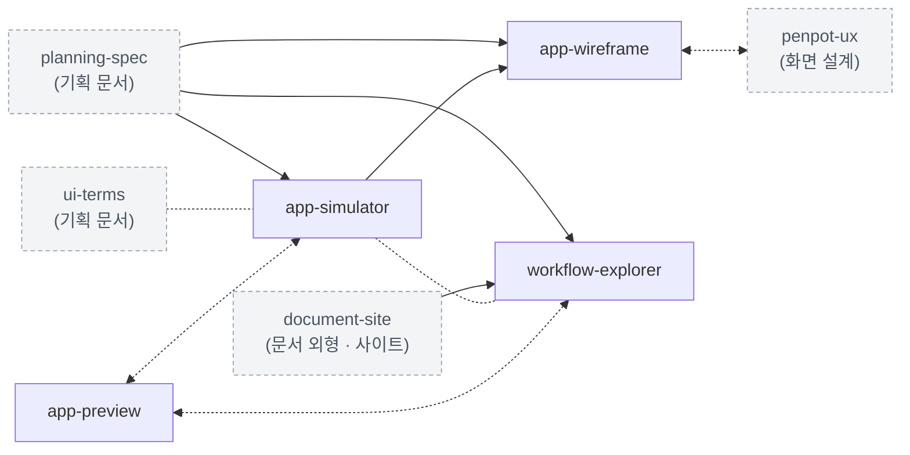

### 화면 설계

**화면 구조 · 흐름 · 와이어프레임을 디자인 도구에서 설계하나요?**

| 모듈 | 하는 일 | 외부 도구 |
|---|---|---|
| `penpot-ux` | Penpot으로 화면 흐름도 · 와이어프레임 · 공통 컴포넌트를 설계합니다 | Penpot |

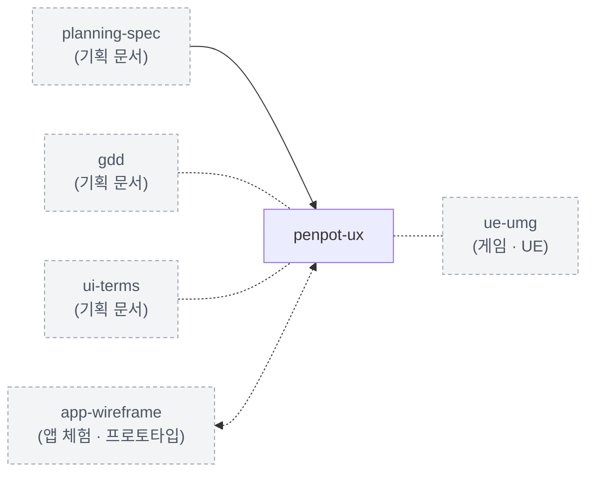

### 게임 프로토타입

**게임 화면과 규칙을 HTML로 만들어 직접 플레이하며 검토하나요?**

| 모듈 | 하는 일 | 외부 도구 |
|---|---|---|
| `game-html` | 게임 화면과 규칙을 한 파일 HTML로 만들어 직접 플레이하며 검토합니다 | — |

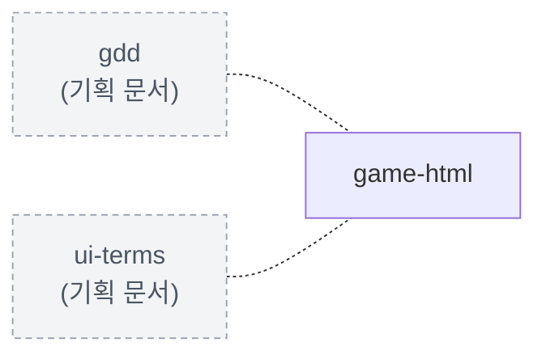

### 게임 · UE

**언리얼 엔진으로 게임을 만드나요?**

| 모듈 | 하는 일 | 외부 도구 |
|---|---|---|
| `ue-build` | UE C++ 프로젝트를 명령으로 빌드하고 게임 창을 직접 조작해 점검합니다 | Unreal Engine |
| `ue-doc` | 언리얼 엔진 문서를 지식 위키와 프로젝트 문서로 나눠 씁니다 | — |
| `ue-localization` | 번역을 시트에서 관리하고 UE 표준 번역 파일로 넣습니다 | Unreal Engine, 스프레드시트 |
| `ue-umg` | UMG 화면을 위젯 블루프린트 대신 C++ 코드로 만들 때의 함정을 피합니다 | Unreal Engine |

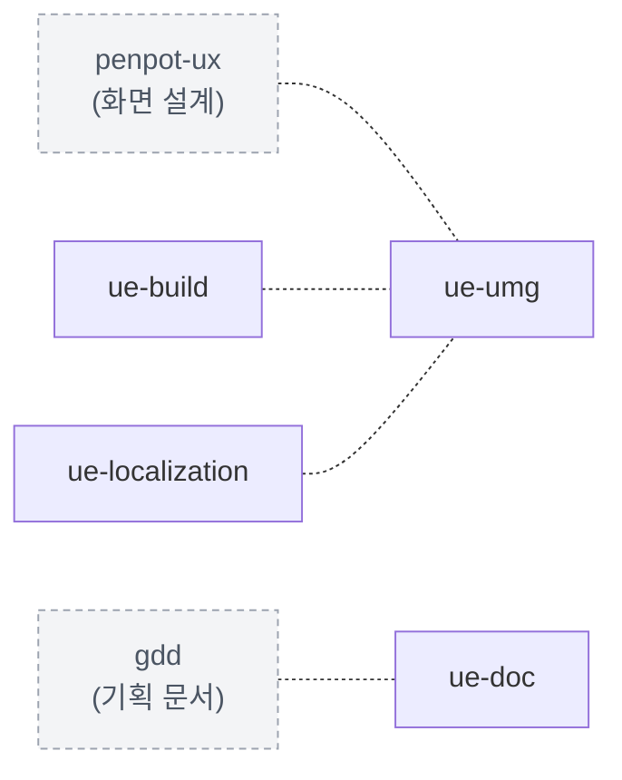

### 아트

**게임 · 앱에 쓸 그림을 만드나요?**

| 모듈 | 하는 일 | 외부 도구 |
|---|---|---|
| `app-asset` | 앱 UI 에셋을 제작하고 한 벌로 관리합니다 | 이미지 생성 도구(선택) |
| `pixel-art` | 픽셀 아트 그림을 같은 규칙으로 만들고 화면에 매끄럽게 올립니다 | Pillow, Aseprite(선택), Spine(선택) |

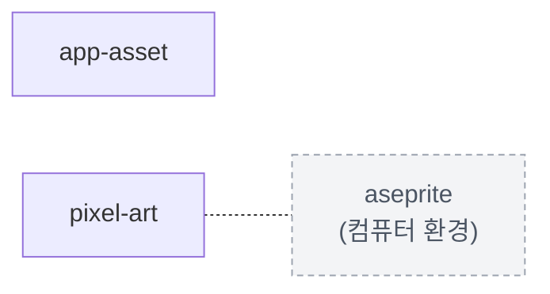

### 역분석

**출시된 게임 · 앱 · 웹의 동작을 소스 없이 분석하나요?**

| 모듈 | 하는 일 | 외부 도구 |
|---|---|---|
| `reverse-analysis` | 출시된 게임 · 앱 · 웹을 소스 없이 분석하고, 근거와 함께 기록합니다 | REA |

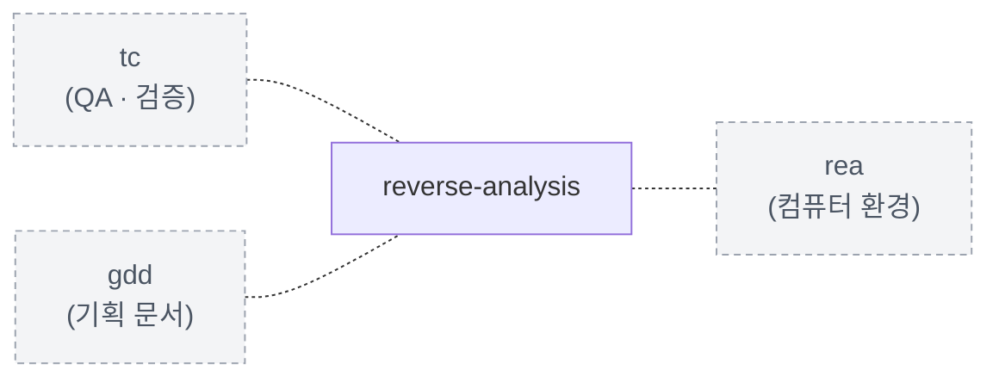

### AI 에이전트 협업

**작업을 여러 AI 에이전트에 나눠 맡기고 그 모습을 지켜보나요?**

| 모듈 | 하는 일 | 외부 도구 |
|---|---|---|
| `agent-office` | AI 에이전트들이 나눠 하는 일을 로컬 사무실 화면에서 지켜봅니다 | AI 사무실 앱, Node.js, Claude Code(선택) |

### 컴퓨터 환경

**이 컴퓨터에 작업 도구를 설치 · 점검하나요?**

| 모듈 | 하는 일 | 외부 도구 |
|---|---|---|
| `android-emulator` (호스트) | Android Emulator 환경을 재현 가능하게 관리합니다 | Android Studio · SDK · Emulator |
| `aseprite` (호스트) | 이 컴퓨터에서 Aseprite를 배치 모드로 돌리고 MCP로 연결하는 환경을 점검합니다 | Aseprite, aseprite MCP 서버(선택) |
| `rea` (호스트) | 이 컴퓨터에 REA(역분석 MCP 서버)를 설치하고 연결 상태를 점검합니다 | REA, Node.js, Ghidra · Hopper · IDA(선택) |

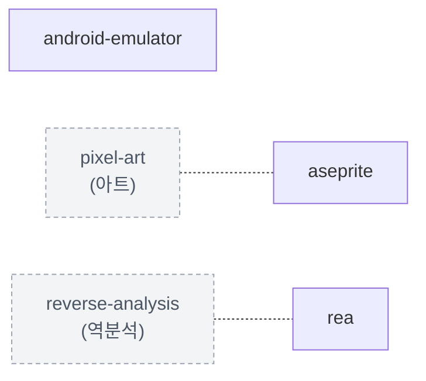

### 밖에서 끌어다 쓰는 도구

모듈이 쓰는 웹 서비스 · 설치 프로그램 · MCP 서버 · 라이브러리입니다. 정본은 각 모듈의 `module.json` `external`입니다.

| 외부 도구 | 종류 | 쓰는 모듈 |
|---|---|---|
| AI 사무실 앱 | 설치 프로그램 | `agent-office` |
| Android Studio · SDK · Emulator | 설치 프로그램 | `android-emulator` |
| Aseprite | 설치 프로그램 | `pixel-art`(선택), `aseprite` |
| aseprite MCP 서버 | MCP 서버 | `aseprite`(선택) |
| Chrome · Edge | 설치 프로그램 | `app-simulator`(선택) |
| Claude Code | 설치 프로그램 | `agent-office`(선택) |
| Figma | 웹 서비스 | `app-wireframe` |
| Figma MCP · 스킬 | MCP 서버 | `app-wireframe` |
| Ghidra · Hopper · IDA | 설치 프로그램 | `rea`(선택) |
| Google Slides | 웹 서비스 | `app-planning-slides`(선택) |
| Microsoft Edge | 설치 프로그램 | `workflow-explorer`(선택) |
| Node.js | 실행 환경 | `app-preview`(선택), `app-simulator`(선택), `agent-office`, `rea` |
| openpyxl | 라이브러리 | `tc` |
| Penpot | 웹 서비스 | `penpot-ux` |
| Pillow | 라이브러리 | `workflow-explorer`(선택), `pixel-art` |
| Playwright | 라이브러리 | `app-preview`(선택), `workflow-explorer`(선택) |
| python-pptx | 라이브러리 | `app-planning-slides` |
| REA | MCP 서버 | `reverse-analysis`, `rea` |
| Spine | 설치 프로그램 | `pixel-art`(선택) |
| Unreal Engine | 설치 프로그램 | `ue-build`, `ue-localization`, `ue-umg` |
| 스프레드시트 | 웹 서비스 | `ue-localization` |
| 이미지 생성 도구 | 웹 서비스 | `app-asset`(선택) |

<!-- module-overview:end -->

## 처음 받기

1. 받는 저장소 루트에 이름표 `workspace.json`을 씁니다(`core/base/rules/site-structure.md` §3).
2. 이 저장소의 도구로 받습니다. 태그가 붙은 판으로 받으려면 `--ref {태그}`를 더합니다.

   ```bash
   python {이 저장소 clone}/core/base/scripts/sync_core.py --from https://github.com/RyuSeoJin/rsj-centralized-control --repo-root {받는 저장소}
   ```
3. 받는 저장소 루트에 진입점과 저장소 이력을 둡니다 — 빈 서식은 `core/base/design-template/repo/`.
4. 기존 프로젝트 폴더가 있으면 옮기지 않고 등록합니다(`core/base/rules/project-scaffold.md` §5).
5. `python core/base/scripts/regen.py`로 읽기 게이트(`AGENTS.md` · `CLAUDE.md` 참조 규칙)와 모듈 지도를
   만들고, `python core/base/scripts/check_rules.py`로 확인합니다.

### AI에게 맡길 때

세션은 받는 저장소에서 열고, 이 저장소 폴더를 함께 추가해 둡니다(「중앙 규칙을 바꾸고 싶을 때」의 배치).
그다음 아래처럼 요청하면 위 1~5를 순서대로 진행합니다.

**이미 있는 저장소에 적용할 때**

> 이 저장소에 중앙 규칙을 처음 받아 주세요. 중앙 규칙 폴더는 `../{이 저장소}`입니다.
> 기존 폴더는 옮기지 말고 프로젝트로 등록해 주세요.

「폴더 구조를 바꿔 주세요」라고 하지 않습니다. 기존 폴더는 옮기지 않고 등록만 합니다 — 옮기면 링크와 참조가
깨집니다(`core/base/rules/project-scaffold.md` §5).

**새 저장소를 만들 때**

> 중앙 규칙을 받은 새 저장소를 `../{새 저장소}`에 만들어 주세요. GitHub에는 private으로 올려 주세요.
> 첫 프로젝트는 `{프로젝트}`이고, `{모듈}` 모듈을 켜 주세요.

폴더 만들기 → `git init` → 처음 받기 → `new_project.py` → 모듈 켜기 순으로 진행하고, GitHub 저장소를 만들고
push하는 단계는 실행 전에 확인을 받습니다. 켤 모듈을 모르면 「모듈 지도를 보고 이 프로젝트에 맞는 모듈을
추천해 주세요」라고 먼저 묻습니다.

- **공개 여부를 꼭 적습니다.** 한 번 공개로 올라간 내용은 나중에 비공개로 바꿔도 그사이 받아 간 사본이 남습니다.
- **이 저장소를 fork하지 않습니다.** 공개 저장소의 fork는 공개입니다. 새 저장소를 만들고 `core/`를 받아 옵니다.

## 다시 받기

```bash
python core/base/scripts/sync_core.py --from https://github.com/RyuSeoJin/rsj-centralized-control --check
python core/base/scripts/sync_core.py --from https://github.com/RyuSeoJin/rsj-centralized-control
```

1. `--check`로 무엇이 바뀌는지와 새 중앙 이력 항목을 먼저 봅니다.
2. 받은 뒤 **새 중앙 이력 항목의 태그를 처리합니다** — 받는 쪽이 할 일이 거기 적혀 있습니다.
3. `regen.py`와 `check_rules.py`를 돌립니다.
4. 받는 저장소의 `repo-change-log.md`에 받은 커밋과 처리한 태그를 적습니다.

자세한 절차는 `core/base/rules/central-sync.md` §2입니다.

**언제 확인하나** — 받는 저장소에서 작업을 시작할 때마다 AI가 먼저 `sync_core.py --check`를 돌립니다
(`--from`을 생략하면 지난번 받은 자리에서 봅니다). 바뀐 것이 있으면 받을지 묻고, 승인 뒤에만 받습니다.
받는 저장소 진입점 서식(`core/base/design-template/repo/CLAUDE.md`)에 이 규칙이 들어 있습니다.

## 프로젝트와 모듈

```bash
python core/base/scripts/new_project.py {프로젝트}          # 관리 파일만 가진 새 프로젝트
python core/base/scripts/module.py list {프로젝트}          # 모듈 목록과 켜짐 상태
python core/base/scripts/module.py on {프로젝트} {모듈}     # 켜기 (off로 끄기)
```

목록은 분야별로 묶여 나옵니다. 하는 일에서 켤 모듈을 찾을 때는 [모듈 지도](core/modules/module-map.md)(분야별
질문 · 함께 쓰는 모듈 · 둘 중 하나를 고르는 기준 · 분야별 연결 그림 · 모듈별 외부 도구와 용도)를 봅니다. 모듈 하나하나의
소개는 그 모듈 폴더의 `module.md`에 있습니다.

모듈을 새로 만들 때는 `module.json`에 분야(`group`) · 짝(`pairs` · `instead`) · 외부 도구(`external`)를 적습니다
(`core/base/rules/feature-request.md` 「모듈의 모양」). 이 README의 「모듈 한눈에」와 모듈 지도는 그 값에서 만들어집니다.

## 중앙 규칙을 바꾸고 싶을 때

받은 저장소에서 `core/`를 직접 고치지 않습니다. 고친 파일이 있으면 다음 받기에서 도구가 멈추고, 덮어쓰면
그 수정이 사라집니다. 대신 이 저장소를 받는 저장소 옆에 받아 두고 작업 세션에 함께 엽니다. 발견한 자리에서
이 저장소를 바로 고치고(프로젝트 이름과 값은 벗깁니다), 받는 저장소는 이 폴더에서 다시 받습니다 — 요청서를 따로
쓰지 않습니다. 함께 열 수 없을 때만 받는 저장소의 `repo-remaining-work.md`에 「중앙에 되돌려 보낼 것」으로
적어 두었다가 옮깁니다(`core/base/rules/central-sync.md` §3).

```
{작업 폴더}/
├─ {이 저장소}/        ← 공개 · 규칙 정본
├─ {받는 저장소 A}/    ← 비공개 · core/ 사본 + 작업물
└─ {받는 저장소 B}/
```

이 저장소가 공개이면, 받는 저장소의 내용이 바깥으로 나가는 길은 이 저장소에 커밋하는 순간뿐입니다. 커밋 전에
바뀐 내용 · `center-change-log.md` 항목 · 커밋 메시지에 프로젝트 이름과 값이 없는지 한 번 훑습니다.

## 지키는 원칙

- **규칙은 여기서만 고칩니다.** 작업 저장소에서 고치면 다음에 받을 때 사라집니다.
- **중앙 규칙에는 특정 프로젝트의 이름 · 값을 적지 않습니다.** 「문장에서 프로젝트 이름을 지워도
  성립하는가」로 중앙 규칙과 프로젝트 규칙을 가릅니다(`core/base/rules/site-structure.md` §2).
- **사람이 지키길 기대하지 않고 도구로 막습니다.** 검사 도구와 GitHub Actions(`.github/workflows/central-gate.yml`)가
  돌고, 프로젝트 파일이 중앙에 섞여 들어오면 합쳐지지 않습니다.
- **목록은 손으로 적지 않습니다.** 모듈 목록 · 연결 · 외부 도구처럼 자주 바뀌는 것은 정본에서 생성합니다.

이 저장소에서 규칙을 고칠 때의 절차와 커밋 전 검사 셋은 [CLAUDE.md](CLAUDE.md)에 있습니다.
