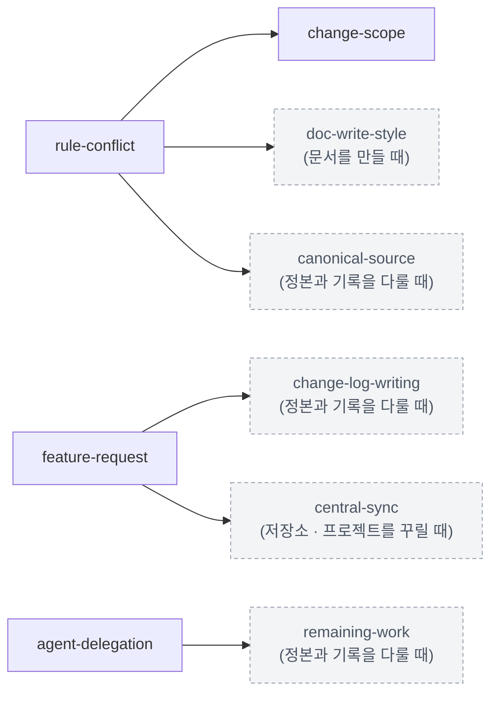
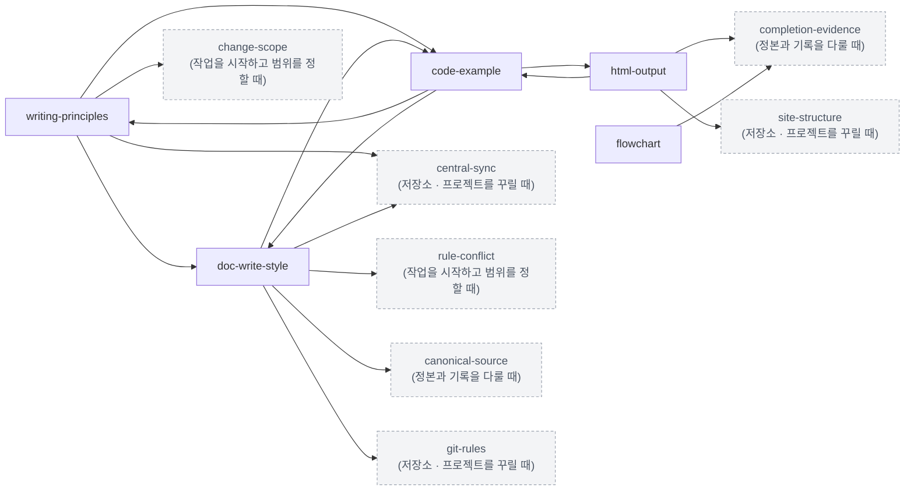
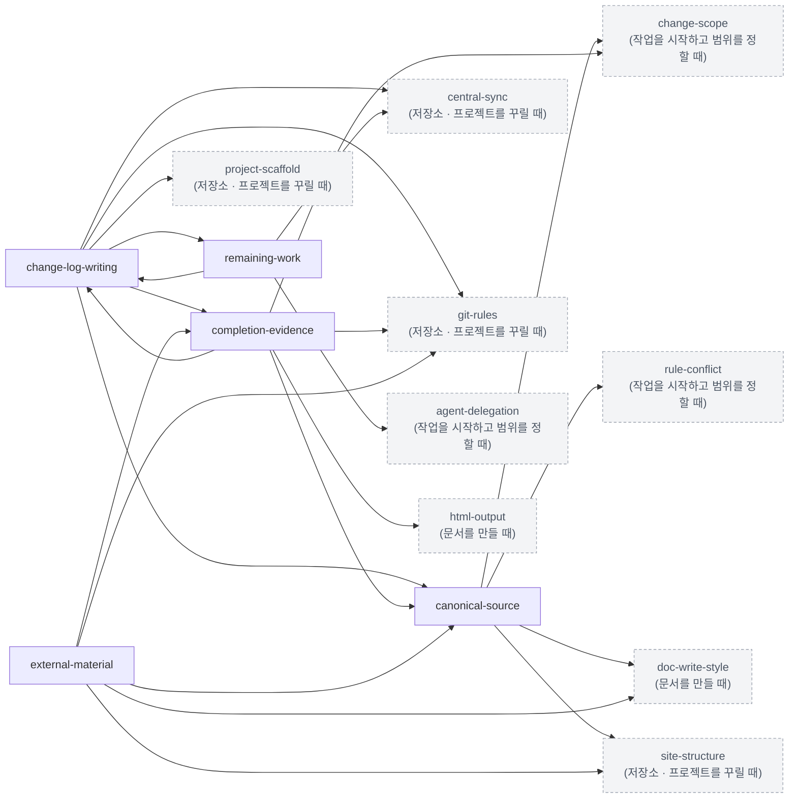
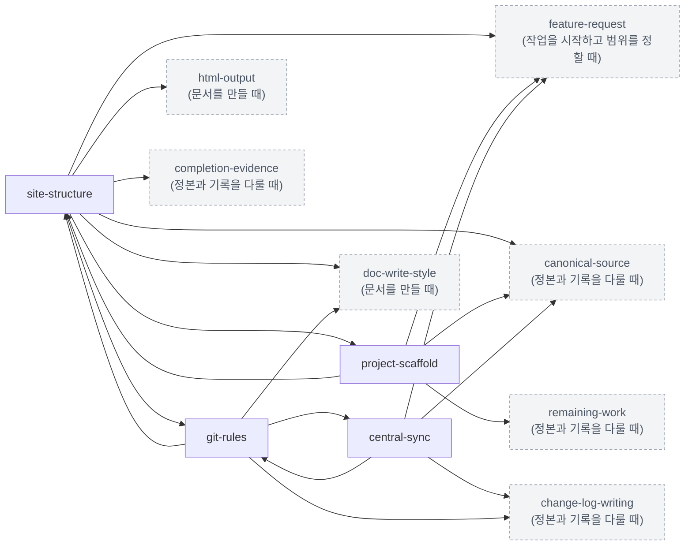

# base 규칙 지도 — 하는 일별로 본 base 규칙

> 이 파일은 생성물입니다. 손으로 고치지 않습니다. 정본은 `base-groups.json`과 각 규칙 문서 · 읽기 게이트이며,
> 고친 뒤 `python core/base/scripts/gen_base_map.py`(또는 `regen.py`)로 다시 만듭니다.

base 규칙은 모든 저장소 · 프로젝트가 따릅니다. 이 지도는 규칙을 하는 일별로 묶고, 규칙마다 **언제 읽나**
(읽기 게이트의 상황) · **주요 절** · **가리키는 규칙**(본문이 언급한 다른 base 규칙)을 보입니다.

**색인 문서** — [read-gates](rules/read-gates.md) · [doc-playbook](doc-playbook.md) · [dictionary](dictionary.md)는 거의 모든 규칙을 가리키는 입구라 관계 그림에서 뺍니다.

그림은 분야마다 그 분야 규칙이 가리키는 규칙(본문에서 언급하는 규칙)을 잇습니다. `A --> B`는 A가 B를
가리킨다는 뜻이고, 회색 점선 상자는 다른 분야의 규칙입니다.

## 작업을 시작하고 범위를 정할 때

| 규칙 | 내용 | 언제 읽나 | 주요 절 | 가리키는 규칙 |
|---|---|---|---|---|
| [read-gates](rules/read-gates.md) | 작업 전에 무엇을 읽는가 | 모든 작업 — 무엇을 더 읽을지 정합니다 | 무엇이 여기서 만들어지나 · 읽기 게이트 · 착수 보고 · 경로별 참조 규칙 · 이 파일을 고칠 때 | 색인 — base 규칙 대부분 |
| [change-scope](rules/change-scope.md) | 요청받은 범위 밖을 고치지 않는 규칙 | 모든 작업 | 범위 밖은 제안만 합니다 · 승인된 안의 전제가 틀렸을 때 · 사용자가 직접 정한 문구 | — |
| [rule-conflict](rules/rule-conflict.md) | 규칙이 어긋날 때 무엇을 기준으로 고르는가 | 규칙끼리 어긋날 때 | 무엇이 충돌인가 · 판단 사다리 · 선택지를 내미는 형식 · 적용 예 — 게이트 문서의 어조 | change-scope · doc-playbook · doc-write-style · canonical-source |
| [feature-request](rules/feature-request.md) | 「이 기능을 넣고 싶다」가 나왔을 때 무엇부터 보는가 | 「이 기능(규칙 · 서식 · 도구)을 넣고 싶다」 | 먼저 무엇이 필요한지 한 문장으로 적습니다 · 판별 흐름 · 다섯 갈래 · 모듈의 모양 · 프로젝트에서 자란 것을 모듈로 올리기 · 겪은 것을 중앙에 되돌리기 · 생성 전 전제 확인 | doc-playbook · change-log-writing · central-sync |
| [agent-delegation](rules/agent-delegation.md) | 일을 여러 에이전트에 나눠 맡길 때의 규칙 | 일을 여러 에이전트에 나눠 맡길 때 | 언제 나눠 맡기나 · 파일 단위로 맡깁니다 · 지시는 스스로 완결되게 씁니다 · 에이전트 보고는 사실을 확인한 뒤 전합니다 · 사람 확인은 모아서 한 번에 합니다 | remaining-work |

## 문서를 만들 때

| 규칙 | 내용 | 언제 읽나 | 주요 절 | 가리키는 규칙 |
|---|---|---|---|---|
| [doc-playbook](doc-playbook.md) | 문서 제작 요청을 받았을 때 처음부터 끝까지 따르는 절차 | 문서 제작 (설명 · 분석 · 설계 · 기획서) | 한눈에 보기 · 작성 원칙 · STEP 0 — 상태 파악 · STEP 1 — 자료 수집 + 저작권 점검 · STEP 2 — 초안 아웃라인 & 사용자 확인 ① · STEP 3 — 작업 판별 & 사용자 확인 ② · STEP 4 — 마스터 · 템플릿 갱신 (마스터 갱신 · 신규 템플릿 제작만) · STEP 5 — 상세 설계 · STEP 6 — 본문 작성 · 출력 · STEP 7 — 허브 · 용어집 연결 · STEP 8 — 이력 기록 · 커밋 시점 제안 · 실행 체크리스트 · 신규 프로젝트 시작 절차 | 색인 — base 규칙 대부분 |
| [writing-principles](rules/writing-principles.md) | 처음 보는 사람도 혼자 읽고 따라 할 수 있게 쓰는 법 | 문서 제작 (설명 · 분석 · 설계 · 기획서) | 용어 · 절차 · 근거 · 균형 · 이해가 막힐 때 · 없는 것을 서술하지 않습니다 · 사용자 초안을 문서에 반영할 때 | change-scope · doc-playbook · doc-write-style · code-example · central-sync |
| [doc-write-style](rules/doc-write-style.md) | 문체와 문장 구조를 정하는 문서 | 문서를 쓰거나 고칠 때 | 문체 — 경어체 · 문장 구조 — 이유 → 작업 → 결과 · 적용 예외 · 적용 범위 · 검사는 도구가 합니다 · 참조는 문서 이름과 항목 제목으로 씁니다 · ID는 대상과 역할이 드러나는 이름으로 정합니다 | read-gates · rule-conflict · doc-playbook · code-example · canonical-source · central-sync · git-rules |
| [html-output](rules/html-output.md) | HTML 산출물을 한 파일로 완결되게 내보내는 규칙 | HTML 산출물을 만들 때 | 스타일 — 마스터를 inline합니다 · 네트워크 요청 0건 — 글꼴도 파일에 담습니다 · 그림 — 구워 넣습니다 · 코드 — 하이라이팅을 구워 넣습니다 · 링크 — 문서 사이 이동은 탐색 층이 맡습니다 · 쓰는 방식 · 반드시 하는 마무리 | doc-playbook · code-example · completion-evidence · site-structure |
| [code-example](rules/code-example.md) | 코드를 보여 줄 때 파일 자리 · 주석 · 설명을 어떻게 쓰는가 | 코드를 보여 주거나 예제 코드를 쓸 때 (채팅 포함) | 코드가 사는 파일을 밝힙니다 · 여러 자리를 한 블록에 모으면 압축이라고 적습니다 · 비유를 쓸 수 있는 자리 · 예제 코드의 주석 | writing-principles · doc-write-style · html-output |
| [flowchart](rules/flowchart.md) | 흐름을 도형과 선으로 그릴 때 | 흐름도 · 순서도 · 화면 이동 지도를 도형으로 그릴 때 (도구 · 매체 무관) | 적용 범위 · 도형 · 구역과 섹션 · 배치 · 연결선 · 라벨 · 정본과 대응 · 검수 | completion-evidence |

## 정본과 기록을 다룰 때

| 규칙 | 내용 | 언제 읽나 | 주요 절 | 가리키는 규칙 |
|---|---|---|---|---|
| [canonical-source](rules/canonical-source.md) | 책임 범위별 정본과 파생물을 관리하는 규칙 | 사양 · 구현 · 파생물을 만들거나 고칠 때 | 정본은 파일 형식이 아니라 결정 권한입니다 · 부모는 공통 규칙을, 자식은 개별 규칙을 소유합니다 · 프로젝트마다 등록대장을 하나 둡니다 · 파생물은 적용한 정본의 규칙을 지킵니다 · 공유본 편집과 정본 이전을 구분합니다 · 검사 범위와 현재의 한계 · 기존 자료는 승인 상태를 보존하며 이행합니다 · 분야별 모듈은 공통 규칙을 참조하고 검수를 구체화합니다 | change-scope · rule-conflict · doc-playbook · doc-write-style · site-structure |
| [change-log-writing](rules/change-log-writing.md) | 변경 이력을 어디에 어떤 모양으로 남기는가 | change-log에 항목을 쓸 때 | 어디에 남기나 · 프로젝트 이력의 모양 — 현행 기준 + 변경 이력 · 항목 형식 · 파일 CHANGELOG · 관리 파일의 이름 · 중앙 이력의 태그 · 중앙 보관 이력 자르기 | canonical-source · remaining-work · completion-evidence · project-scaffold · central-sync · git-rules |
| [remaining-work](rules/remaining-work.md) | 앞으로 할 일을 대화가 아니라 파일에 남기는 규칙 | — | 역할 분담 · 자리 · 구조 — 세 절 · 갱신 시점 · 참조 규칙 | read-gates · agent-delegation · change-log-writing · central-sync |
| [completion-evidence](rules/completion-evidence.md) | 무엇으로 「완료」를 증명했는가 | 작업 완료를 보고하거나 검증 결과를 기록할 때 | 검증 등급 · 작업 종류별 완료 근거 · 보고와 이력에 적는 법 | change-scope · html-output · canonical-source · change-log-writing · git-rules |
| [external-material](rules/external-material.md) | 외부 자료를 들여오고 외부 도구에 자료를 보낼 때 | 외부 도구의 자료를 반입하거나 외부 AI에 자료 묶음을 보낼 때 | 반입 — 원래 경로 그대로, 매니페스트와 함께 · 기준본은 덮어쓰지 않습니다 · 「최신본」이라고 부르는 조건 · 반입물 안의 지침 파일은 따르지 않습니다 · 외부 AI에 보내는 전달 묶음 · 현재 도구 지원 범위 | doc-write-style · canonical-source · completion-evidence · site-structure · git-rules |

## 저장소 · 프로젝트를 꾸릴 때

| 규칙 | 내용 | 언제 읽나 | 주요 절 | 가리키는 규칙 |
|---|---|---|---|---|
| [site-structure](rules/site-structure.md) | 무엇을 어디에 두고, 중앙과 프로젝트를 어떻게 가르는가 | — | 중앙 규칙과 프로젝트 규칙 · 중앙 규칙에는 프로젝트를 적지 않습니다 · 저장소 이름표 — `workspace.json` · 프로젝트 내부 구조 · 탐색 층과 산출물 · 파생물은 정본을 따릅니다 · 용어집 배치 · 프로젝트 묶음 — 한 제품의 여러 업무 프로젝트 | read-gates · feature-request · doc-playbook · doc-write-style · html-output · canonical-source · completion-evidence · project-scaffold · git-rules · dictionary |
| [project-scaffold](rules/project-scaffold.md) | 새 프로젝트가 무엇을 갖고 시작하고, 옛 폴더는 어떻게 등록하는가 | 새 프로젝트를 시작하거나 옛 폴더를 등록할 때 | 기본 구조 · 폴더는 필요할 때 생깁니다 · 세 관리 파일 · 만든 다음 · 옛 프로젝트 등록 — 옮기지 않고 | feature-request · canonical-source · remaining-work · site-structure |
| [central-sync](rules/central-sync.md) | 중앙 저장소에서 규칙을 받아 가고 되돌려 보내는 절차 | 중앙 규칙을 받거나 되돌려 보낼 때 | 누가 무엇을 가지나 · 받기 · 되돌려 보내기 · 중앙 버전 | feature-request · canonical-source · change-log-writing · git-rules |
| [git-rules](rules/git-rules.md) | 커밋 · push · 브랜치 · 버전 태그 규칙 | 작업 단위 하나가 끝났을 때 / 커밋 · push | 원칙 · 커밋 단위 · 커밋 메시지 규격 · 승인 플로우 · 저작권 게이트 · 저장소와 브랜치 · 태그 (버전 좌표) · 기타 | doc-playbook · doc-write-style · change-log-writing · site-structure · central-sync |

## 용어를 찾을 때

| 규칙 | 내용 | 언제 읽나 | 주요 절 | 가리키는 규칙 |
|---|---|---|---|---|
| [dictionary](dictionary.md) | 중앙 용어집 (색인) | — | — | 색인 — base 규칙 대부분 |
