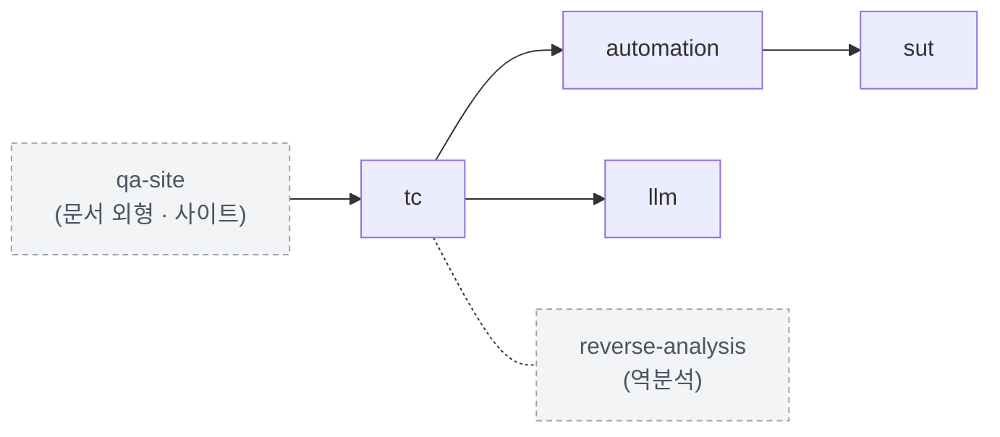
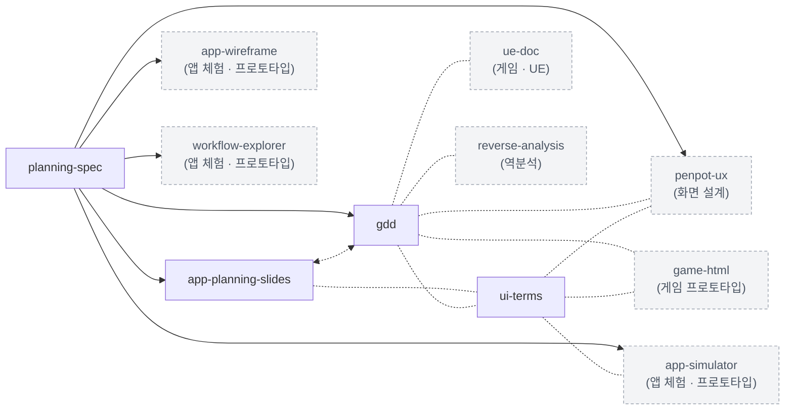
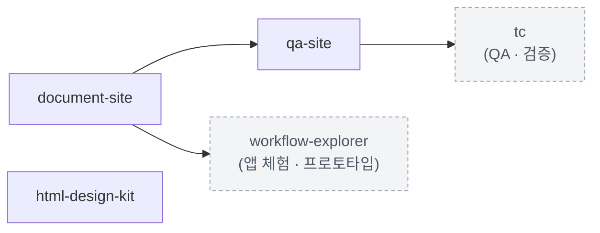
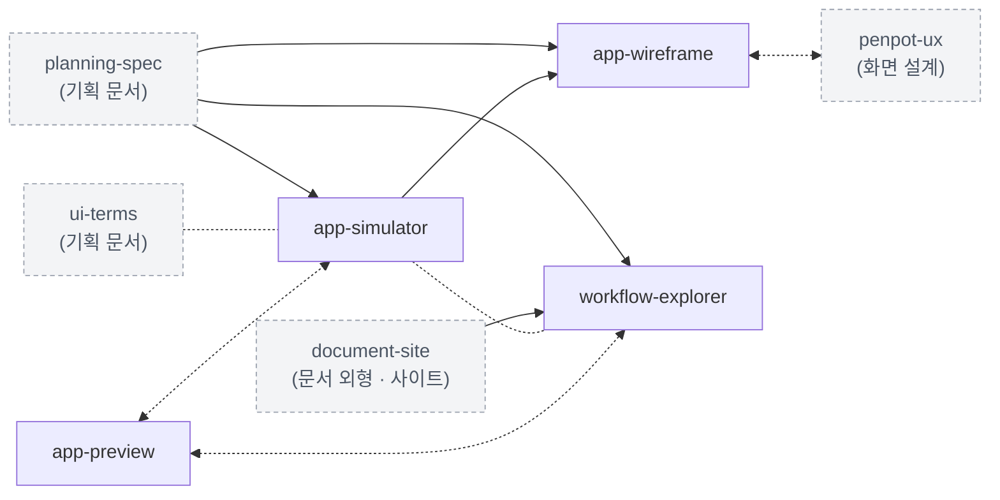
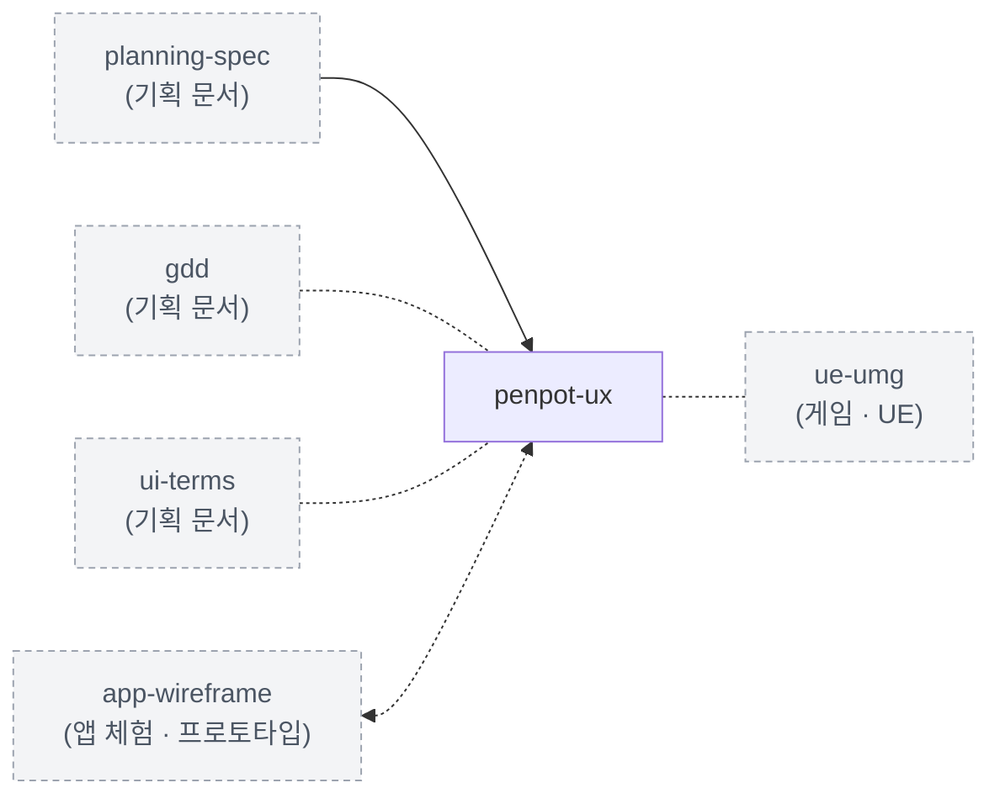
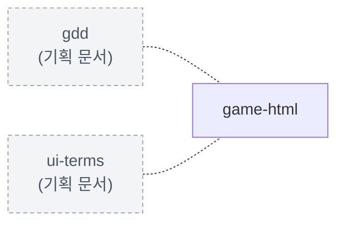
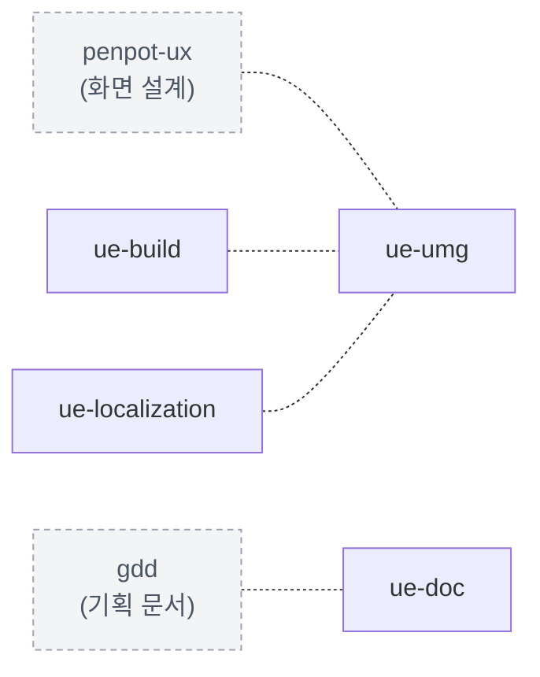
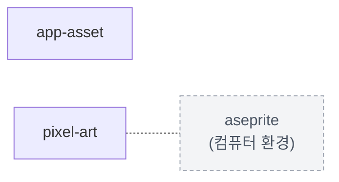
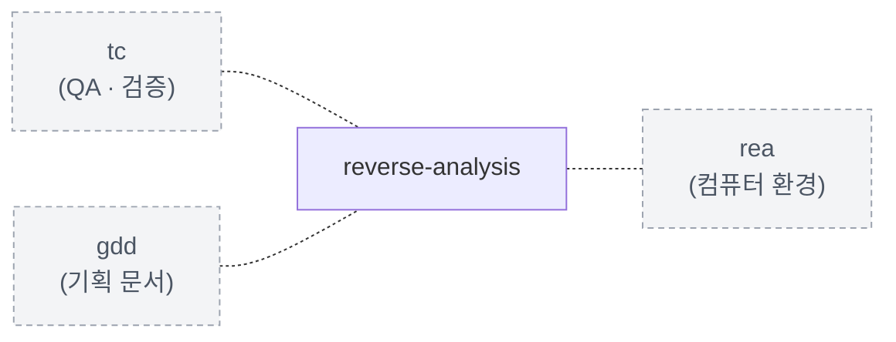
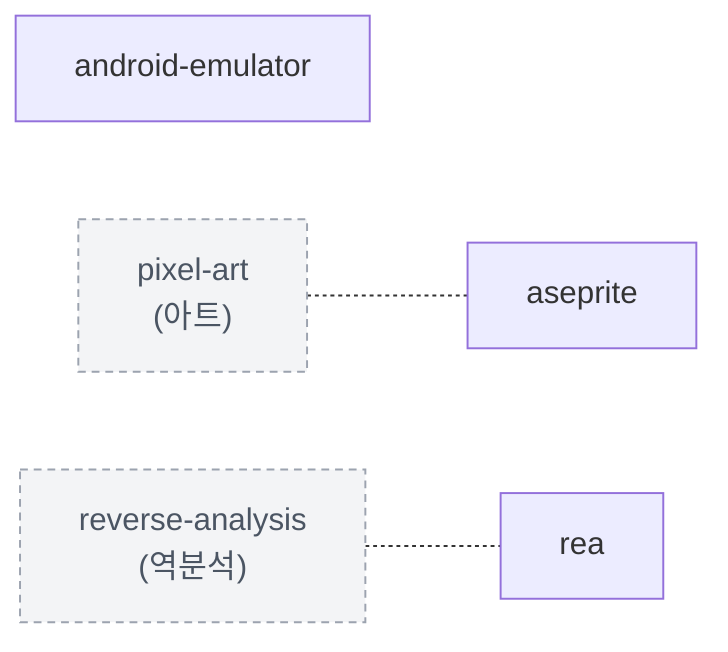

# 모듈 지도 — 하는 일에서 켤 모듈을 찾습니다

> 이 파일은 생성물입니다. 손으로 고치지 않습니다. 정본은 `groups.json`과 각 모듈의
> `module.json` · `module.md`이며, 고친 뒤 `python core/base/scripts/gen_module_map.py`(또는 `regen.py`)로 다시 만듭니다.

모듈이 많아 목록만으로는 고르기 어렵습니다. 이 지도는 **하는 일**에서 출발해 켤 모듈에
닿게 합니다. 모듈 하나의 자세한 내용은 그 모듈의 `module.md`에 있습니다. 켜져 있는지는
`python core/base/scripts/module.py list {프로젝트}`로 봅니다.

## 1. 어떤 일을 하나요?

분야마다 질문 하나가 있습니다. 「예」이면 그 아래 모듈의 「언제 켜나」를 읽고 고릅니다.
전제 사슬은 왼쪽이 그 모듈이고 오른쪽 끝이 가장 먼저 켜는 모듈입니다.

### QA · 검증 — 만든 것을 테스트 케이스로 검증하나요?

- `tc` — 테스트 케이스를 설계하고 시트로 냅니다
  - 언제 켜나: 이 프로젝트에서 테스트 케이스를 만드는가? 만든다면 켭니다.
  - 전제 사슬: `tc` ← `qa-site` ← `document-site`
- `automation` — TC를 사람이 아니라 코드가 돌립니다
  - 언제 켜나: TC를 코드로 돌리는가?
  - 전제 사슬: `automation` ← `tc` ← `qa-site` ← `document-site`
- `sut` — 검증 대상을 직접 만들고 결함을 심어 탐지력을 봅니다
  - 언제 켜나: 검증 대상을 이 저장소 안에서 직접 만드는가?
  - 전제 사슬: `sut` ← `automation` ← `tc` ← `qa-site` ← `document-site`
- `llm` — 출력을 생성하는 기능을 무엇으로 검증하는가
  - 언제 켜나: 같은 입력에 출력이 매번 달라지는 기능이 있는가?
  - 전제 사슬: `llm` ← `tc` ← `qa-site` ← `document-site`

### 기획 문서 — 구현 전에 기획을 문서로 합의 · 공유하나요?

- `planning-spec` — 기능 골격과 상세 사양으로 기획 정본을 작성합니다
  - 언제 켜나: 기능 골격과 상세 사양을 기획 정본으로 작성하거나 개정할 때 켭니다. 정본을 독자용 요약본으로 줄여 공유할 때도 켭니다. 이미 승인된 정본을 표현하거나 구현하는 모듈에서 필수 참조로 지정한 경우에도 함께 켭니다. 그 밖의 모듈도 base의 정본 관리 규칙을 따릅니다.
- `app-planning-slides` — 앱 기획 문서를 프롬프트로 채워 Google Slides로 냅니다
  - 언제 켜나: 기획자 · 디자이너 · 개발자가 함께 보는 앱 기획 문서를 슬라이드로 공유하는가? 그렇다면 켭니다. 구현 전 시스템 하나를 깊게 합의하는 HTML 기획서가 목적이면 `gdd` 모듈이 맞습니다.
  - 전제 사슬: `app-planning-slides` ← `planning-spec`
- `gdd` — 코드 전에 시스템 하나를 합의하는 기획서를 쓰고, 프로토타입으로 확인합니다
  - 언제 켜나: 구현 전에 기획을 문서로 합의하는가? 그렇다면 켭니다. 구현 문서만 쓰는 프로젝트라면 켜지 않습니다. UE 프로젝트라면 구현 문서를 위해 ue-doc 모듈도 함께 켭니다.
  - 전제 사슬: `gdd` ← `planning-spec`
- `ui-terms` — 화면 부품을 같은 이름으로 부르는 UI 용어집
  - 언제 켜나: 화면(웹 · 앱 · 게임 UI)을 글로 설명하거나 AI에게 화면을 만들어 달라고 요청하는가? 그렇다면 켭니다. 화면 없이 문서 · 도구 · 데이터만 다루는 프로젝트라면 켜지 않습니다.

### 문서 외형 · 사이트 — 문서를 한 사이트나 공용 디자인으로 묶어 내나요?

- `document-site` (워크스페이스) — 공통 HTML 디자인과 문서 탐색을 제공합니다
  - 언제 켜나: 저장소의 문서를 공통 셸과 디자인으로 연결할 때 켭니다. workspace.json의 modules에 등록합니다.
- `qa-site` (워크스페이스) — QA 분석 서식과 메뉴를 공통 문서 사이트에 더합니다
  - 언제 켜나: 공통 문서 사이트에 QA 분석 문서와 TC 관계도 서식이 필요한가? 그렇다면 켭니다. 저장소 전체에 걸리는 워크스페이스 모듈이므로 `workspace.json`의 `modules`에 적습니다. 문서를 사이트로 묶기 위한 공통 기능만 필요하면 `document-site`를 사용합니다.
  - 전제 사슬: `qa-site` ← `document-site`
- `html-design-kit` — 자기완결 HTML 문서를 조립하는 공용 디자인 킷
  - 언제 켜나: 프로젝트별로 확장 가능한 HTML 문서를 공용 부품과 테마로 만들거나 고칠 때 켭니다.

### 앱 체험 · 프로토타입 — 앱 화면과 흐름을 직접 눌러 보며 검토하나요?

- `app-preview` — 가상 화면에서 앱 플로우를 비교하는 체험 도구
  - 언제 켜나: 앱 화면을 여러 가상 뷰포트에서 선택·추가·비교할 때 켭니다.
- `app-simulator` — 앱 프로토타입을 기기 틀 안에서 돌리는 시뮬레이터
  - 언제 켜나: 앱 화면과 동작을 프로토타입으로 만들어, 실제 기기처럼 조작하며 검토해야 할 때 켭니다.
  - 전제 사슬: `app-simulator` ← `planning-spec`
- `app-wireframe` — 시뮬레이터를 키트 기반 Figma 와이어프레임으로 정리합니다
  - 언제 켜나: 기획 정본과 시뮬레이터의 화면·상태를 편집 가능한 Figma Design 와이어프레임으로 정리할 때 켭니다.
  - 전제 사슬: `app-wireframe` ← `app-simulator` ← `planning-spec`
- `workflow-explorer` — 앱 워크플로우를 조작하며 따라가는 탐색기
  - 언제 켜나: 앱·서비스의 사용자 흐름을 기획자·개발자가 함께 따라가며 검토해야 할 때 켭니다. 흐름 데이터가 이미 있거나, 기획서·구현에서 흐름을 정리할 프로젝트가 대상입니다.
  - 전제 사슬: `workflow-explorer` ← `document-site` ← `planning-spec`

### 화면 설계 — 화면 구조 · 흐름 · 와이어프레임을 디자인 도구에서 설계하나요?

- `penpot-ux` — Penpot으로 화면 흐름도 · 와이어프레임 · 공통 컴포넌트를 설계합니다
  - 언제 켜나: 화면 구조 · 흐름 · 와이어프레임을 Penpot에서 설계하는가? 그렇다면 켭니다. 앱 시뮬레이터의 화면을 Figma 키트로 옮기는 것이 목적이면 `app-wireframe`이 맞습니다.
  - 전제 사슬: `penpot-ux` ← `planning-spec`

### 게임 프로토타입 — 게임 화면과 규칙을 HTML로 만들어 직접 플레이하며 검토하나요?

- `game-html` — 게임 화면과 규칙을 한 파일 HTML로 만들어 직접 플레이하며 검토합니다
  - 언제 켜나: 게임 화면과 규칙을 HTML로 만들어 직접 플레이하며 검토하는가? 그렇다면 켭니다. 기획서와 함께 쓰려면 gdd 모듈을 함께 켭니다 — gdd는 기획서 → 프로토타입 → 구현의 순서를, 이 모듈은 그 프로토타입을 만드는 법을 정합니다. 앱 화면 흐름을 기기 틀에서 보려는 것이면 app-simulator가 맞습니다.

### 게임 · UE — 언리얼 엔진으로 게임을 만드나요?

- `ue-build` — UE C++ 프로젝트를 명령으로 빌드하고 게임 창을 직접 조작해 점검합니다
  - 언제 켜나: UE C++ 프로젝트를 이 저장소에서 빌드하고 실행 점검하는가? 그렇다면 켭니다.
- `ue-doc` — 언리얼 엔진 문서를 지식 위키와 프로젝트 문서로 나눠 씁니다
  - 언제 켜나: 언리얼 엔진 문서를 쓰는가? 엔진 지식을 모으는 위키 프로젝트와, 그 지식으로 게임을 만드는 개발 프로젝트 둘 다 켭니다. 어느 쪽인지는 그 프로젝트의 `{폴더}-site.json`의 `track`이 정합니다.
- `ue-localization` — 번역을 시트에서 관리하고 UE 표준 번역 파일로 넣습니다
  - 언제 켜나: 게임 문구를 여러 언어로 내는가? 그렇다면 켭니다.
- `ue-umg` — UMG 화면을 위젯 블루프린트 대신 C++ 코드로 만들 때의 함정을 피합니다
  - 언제 켜나: UI를 위젯 블루프린트가 아니라 C++ 코드로 만드는가? 그렇다면 켭니다. 위젯 블루프린트 편집기로 화면을 짜고 C++는 로직만 맡는 프로젝트라면 켜지 않습니다.

### 아트 — 게임 · 앱에 쓸 그림을 만드나요?

- `app-asset` — 앱 UI 에셋을 제작하고 한 벌로 관리합니다
  - 언제 켜나: 이 프로젝트가 화면에 쓰는 이미지 에셋을 직접 만들거나, 여러 화면 · 기기가 함께 쓰는 에셋을 등록부로 관리하는가? 그렇다면 켭니다.
- `pixel-art` — 픽셀 아트 그림을 같은 규칙으로 만들고 화면에 매끄럽게 올립니다
  - 언제 켜나: 픽셀 아트로 게임 · 앱의 그림(캐릭터 · 타일 · 배경 · UI · 이펙트)을 만들거나, 픽셀 아트를 화면에 올리는 규칙(해상도 · 카메라 · 움직임)을 정하는가? 그렇다면 켭니다.

### 역분석 — 출시된 게임 · 앱 · 웹의 동작을 소스 없이 분석하나요?

- `reverse-analysis` — 출시된 게임 · 앱 · 웹을 소스 없이 분석하고, 근거와 함께 기록합니다
  - 언제 켜나: 출시된 게임 · 앱 · 웹의 동작을 소스 없이 분석해 기획 · 검증 · 구현의 근거로 쓰는가? 그렇다면 켭니다. 화면을 보고 쓰는 역기획만 하고 실행 파일 · 패키지 · 네트워크를 들여다보지 않는다면 켜지 않습니다.

### AI 에이전트 협업 — 작업을 여러 AI 에이전트에 나눠 맡기고 그 모습을 지켜보나요?

- `agent-office` — AI 에이전트들이 나눠 하는 일을 로컬 사무실 화면에서 지켜봅니다
  - 언제 켜나: 작업을 여러 AI 에이전트에 나눠 맡기고, 그 모습을 로컬 사무실 화면에서 지켜보나? 그렇다면 켭니다. 에이전트를 쓰지 않거나, 맡긴 결과만 대화로 받으면 충분한 프로젝트는 켜지 않습니다.

### 컴퓨터 환경 — 이 컴퓨터에 작업 도구를 설치 · 점검하나요?

- `android-emulator` (호스트) — Android Emulator 환경을 재현 가능하게 관리합니다
- `aseprite` (호스트) — 이 컴퓨터에서 Aseprite를 배치 모드로 돌리고 MCP로 연결하는 환경을 점검합니다
  - 언제 켜나: 켜지 않습니다. 호스트 모듈이라 프로젝트에 붙지 않고, Aseprite로 작업할 컴퓨터에서 점검 도구로 설치 상태만 확인합니다.
- `rea` (호스트) — 이 컴퓨터에 REA(역분석 MCP 서버)를 설치하고 연결 상태를 점검합니다
  - 언제 켜나: 켜지 않습니다. 호스트 모듈이라 프로젝트에 붙지 않고, REA로 역분석할 컴퓨터에서 점검 도구로 설치 상태만 확인합니다.

## 2. 적용 범위

| 범위 | 켜는 자리 | 모듈 |
|---|---|---|
| 프로젝트 | `module.py on {프로젝트} {모듈}` — 그 프로젝트의 `{폴더}-modules.json`에 남습니다 | 아래 둘에 들지 않는 모든 모듈 |
| 워크스페이스 | `workspace.json`의 `modules` — 저장소 전체에 켜집니다 | `document-site` · `qa-site` |
| 호스트 | 프로젝트에 켜지 않습니다 — 이 컴퓨터의 환경을 다룰 때만 읽습니다 | `android-emulator` · `aseprite` · `rea` |

## 3. 함께 쓰는 모듈

전제는 아니지만 함께 켜면 더 잘 맞는 짝입니다. 한쪽을 켰다면 다른 쪽도 살펴봅니다.

| 모듈 | 함께 쓰는 모듈 | 이유 |
|---|---|---|
| `tc` | `reverse-analysis` | 역분석한 기능의 동작에서 테스트 케이스를 뽑을 때 함께 켬 |
| `app-planning-slides` | `ui-terms` | 앱 기획 문서의 화면 설명을 이 용어집의 이름으로 씀 |
| `gdd` | `ui-terms` | 기획서에 화면을 적을 때 부품 이름을 이 용어집으로 맞춤 |
| `gdd` | `penpot-ux` | 기획서의 화면 목록 · 존 지도를 Penpot 보드로 그려 합의할 때 함께 켬 |
| `gdd` | `game-html` | 게임 프로토타입을 HTML로 만들 때 그 만드는 법 · 서식 · 점검 도구를 함께 씀 / 기획서로 합의한 규칙을 이 모듈의 프로토타입으로 확인할 때 함께 켬 |
| `gdd` | `ue-doc` | UE 프로젝트면 구현 문서용으로 함께 켬 / 구현 전에 기획을 문서로 합의하면 함께 켬 |
| `gdd` | `reverse-analysis` | 역분석으로 알아낸 시스템을 역기획서 · 자기 기획서로 정리할 때 함께 켬 |
| `ui-terms` | `app-simulator` | 앱 프로토타입의 화면을 요청 · 검토할 때 부품 이름을 맞춤 |
| `ui-terms` | `penpot-ux` | 보드 · 컴포넌트 이름을 화면 부품 용어집의 이름으로 맞춤 |
| `ui-terms` | `game-html` | HTML 프로토타입의 화면을 AI에게 요청할 때 용어 + 동작 + 조건으로 씀 |
| `app-simulator` | `workflow-explorer` | 탐색기 안에서 시뮬레이터를 불러 흐름을 따라감 |
| `penpot-ux` | `ue-umg` | 보드의 Flex · Grid 값을 사양으로 읽어 UMG C++ 화면으로 옮길 때 함께 켬 |
| `ue-build` | `ue-umg` | 코드로 만든 UI를 빌드하고 자동 시험 · 화면 사진으로 확인할 때 함께 켬 |
| `ue-localization` | `ue-umg` | 여러 언어의 글자 폭 · 번역 없음을 UI 칸과 함께 볼 때 함께 켬 |
| `pixel-art` | `aseprite` | Aseprite 실행 · 배치 모드 환경 점검을 맡음 / Aseprite로 그리는 픽셀 아트의 그림 규칙을 맡음 |
| `reverse-analysis` | `rea` | 이 컴퓨터의 REA 설치 · MCP 등록 · 분석 엔진 점검을 맡음 / REA로 역분석하는 절차 · 허가 범위 · 근거 기록 규칙을 맡음 |

## 4. 둘 중 하나를 고르는 모듈

하는 일이 겹쳐 보통 하나만 켜는 짝입니다. 어느 쪽이 맞는지는 아래 기준으로 가립니다.

| 이 모듈 | 이쪽이 맞을 때 | 저 모듈 | 저쪽이 맞을 때 |
|---|---|---|---|
| `app-planning-slides` | 앱 기획 문서를 슬라이드로 공유하는 것이 목적일 때 | `gdd` | 구현 전 시스템 하나를 깊게 합의하는 HTML 기획서가 목적일 때 |
| `app-preview` | 화면 데이터를 여러 기기 크기에서 나란히 비교할 때 | `app-simulator` | 프로토타입 앱 하나를 기기 틀과 개발용 조작으로 돌려 볼 때 |
| `app-preview` | 화면 크기별 전환 비교가 목적일 때 | `workflow-explorer` | 흐름의 갈래와 주체(유저 · 시스템)를 따라가며 읽을 때 |
| `app-wireframe` | 앱 시뮬레이터의 화면을 Figma 키트로 와이어프레임을 만들 때 | `penpot-ux` | 시뮬레이터 없이 Penpot에서 화면 흐름도 · 와이어프레임을 설계할 때 |

## 5. 분야별 연결

그림에서 `A --> B`는 B를 켜려면 A가 먼저 켜져 있어야 한다는 뜻(전제)입니다. 점선은 함께 켜면 더 잘 맞는 짝, 양쪽 화살표 점선은 하는 일이 겹쳐 보통 하나만 켜는 짝입니다. 회색 점선 상자는 다른 분야의 모듈입니다. (선택)은 그 모듈의 일부 기능에만 필요한 외부 도구입니다.

### QA · 검증

**만든 것을 테스트 케이스로 검증하나요?**

| 모듈 | 하는 일 | 외부 도구 |
|---|---|---|
| `tc` | 테스트 케이스를 설계하고 시트로 냅니다 | openpyxl |
| `automation` | TC를 사람이 아니라 코드가 돌립니다 | — |
| `sut` | 검증 대상을 직접 만들고 결함을 심어 탐지력을 봅니다 | — |
| `llm` | 출력을 생성하는 기능을 무엇으로 검증하는가 | — |

### 기획 문서

**구현 전에 기획을 문서로 합의 · 공유하나요?**

| 모듈 | 하는 일 | 외부 도구 |
|---|---|---|
| `planning-spec` | 기능 골격과 상세 사양으로 기획 정본을 작성합니다 | — |
| `app-planning-slides` | 앱 기획 문서를 프롬프트로 채워 Google Slides로 냅니다 | python-pptx, Google Slides(선택) |
| `gdd` | 코드 전에 시스템 하나를 합의하는 기획서를 쓰고, 프로토타입으로 확인합니다 | — |
| `ui-terms` | 화면 부품을 같은 이름으로 부르는 UI 용어집 | — |

### 문서 외형 · 사이트

**문서를 한 사이트나 공용 디자인으로 묶어 내나요?**

| 모듈 | 하는 일 | 외부 도구 |
|---|---|---|
| `document-site` (워크스페이스) | 공통 HTML 디자인과 문서 탐색을 제공합니다 | — |
| `qa-site` (워크스페이스) | QA 분석 서식과 메뉴를 공통 문서 사이트에 더합니다 | — |
| `html-design-kit` | 자기완결 HTML 문서를 조립하는 공용 디자인 킷 | — |

### 앱 체험 · 프로토타입

**앱 화면과 흐름을 직접 눌러 보며 검토하나요?**

| 모듈 | 하는 일 | 외부 도구 |
|---|---|---|
| `app-preview` | 가상 화면에서 앱 플로우를 비교하는 체험 도구 | Node.js(선택), Playwright(선택) |
| `app-simulator` | 앱 프로토타입을 기기 틀 안에서 돌리는 시뮬레이터 | Node.js(선택), Chrome · Edge(선택) |
| `app-wireframe` | 시뮬레이터를 키트 기반 Figma 와이어프레임으로 정리합니다 | Figma, Figma MCP · 스킬 |
| `workflow-explorer` | 앱 워크플로우를 조작하며 따라가는 탐색기 | Playwright(선택), Pillow(선택), Microsoft Edge(선택) |

### 화면 설계

**화면 구조 · 흐름 · 와이어프레임을 디자인 도구에서 설계하나요?**

| 모듈 | 하는 일 | 외부 도구 |
|---|---|---|
| `penpot-ux` | Penpot으로 화면 흐름도 · 와이어프레임 · 공통 컴포넌트를 설계합니다 | Penpot |

### 게임 프로토타입

**게임 화면과 규칙을 HTML로 만들어 직접 플레이하며 검토하나요?**

| 모듈 | 하는 일 | 외부 도구 |
|---|---|---|
| `game-html` | 게임 화면과 규칙을 한 파일 HTML로 만들어 직접 플레이하며 검토합니다 | — |

### 게임 · UE

**언리얼 엔진으로 게임을 만드나요?**

| 모듈 | 하는 일 | 외부 도구 |
|---|---|---|
| `ue-build` | UE C++ 프로젝트를 명령으로 빌드하고 게임 창을 직접 조작해 점검합니다 | Unreal Engine |
| `ue-doc` | 언리얼 엔진 문서를 지식 위키와 프로젝트 문서로 나눠 씁니다 | — |
| `ue-localization` | 번역을 시트에서 관리하고 UE 표준 번역 파일로 넣습니다 | Unreal Engine, 스프레드시트 |
| `ue-umg` | UMG 화면을 위젯 블루프린트 대신 C++ 코드로 만들 때의 함정을 피합니다 | Unreal Engine |

### 아트

**게임 · 앱에 쓸 그림을 만드나요?**

| 모듈 | 하는 일 | 외부 도구 |
|---|---|---|
| `app-asset` | 앱 UI 에셋을 제작하고 한 벌로 관리합니다 | 이미지 생성 도구(선택) |
| `pixel-art` | 픽셀 아트 그림을 같은 규칙으로 만들고 화면에 매끄럽게 올립니다 | Pillow, Aseprite(선택), Spine(선택) |

### 역분석

**출시된 게임 · 앱 · 웹의 동작을 소스 없이 분석하나요?**

| 모듈 | 하는 일 | 외부 도구 |
|---|---|---|
| `reverse-analysis` | 출시된 게임 · 앱 · 웹을 소스 없이 분석하고, 근거와 함께 기록합니다 | REA |

### AI 에이전트 협업

**작업을 여러 AI 에이전트에 나눠 맡기고 그 모습을 지켜보나요?**

| 모듈 | 하는 일 | 외부 도구 |
|---|---|---|
| `agent-office` | AI 에이전트들이 나눠 하는 일을 로컬 사무실 화면에서 지켜봅니다 | AI 사무실 앱, Node.js, Claude Code(선택) |

### 컴퓨터 환경

**이 컴퓨터에 작업 도구를 설치 · 점검하나요?**

| 모듈 | 하는 일 | 외부 도구 |
|---|---|---|
| `android-emulator` (호스트) | Android Emulator 환경을 재현 가능하게 관리합니다 | Android Studio · SDK · Emulator |
| `aseprite` (호스트) | 이 컴퓨터에서 Aseprite를 배치 모드로 돌리고 MCP로 연결하는 환경을 점검합니다 | Aseprite, aseprite MCP 서버(선택) |
| `rea` (호스트) | 이 컴퓨터에 REA(역분석 MCP 서버)를 설치하고 연결 상태를 점검합니다 | REA, Node.js, Ghidra · Hopper · IDA(선택) |

## 6. 밖에서 끌어다 쓰는 도구

모듈이 쓰는 웹 서비스 · 설치 프로그램 · MCP 서버 · 라이브러리 · 실행 환경입니다. 「선택」은 그
모듈의 일부 기능에만 필요합니다. 정본은 각 모듈의 `module.json` `external`입니다.

| 외부 도구 | 종류 | 모듈 | 꼭 있어야 하나 | 용도 |
|---|---|---|---|---|
| AI 사무실 앱 | 설치 프로그램 | `agent-office` | 예 | 에이전트 업무를 사무실 화면과 업무 일지로 보여 주는 로컬 앱(기본 127.0.0.1:4318) |
| Android Studio · SDK · Emulator | 설치 프로그램 | `android-emulator` | 예 | 가상 기기(AVD) 구성과 실행 |
| Aseprite | 설치 프로그램 | `pixel-art` | 선택 | 그림 편집 · 배치 모드 — 설치 점검은 aseprite 모듈 |
|  |  | `aseprite` | 예 | 1.3 이상 · 배치 모드 실행(유료 프로그램이라 도구가 설치하지 않음) |
| aseprite MCP 서버 | MCP 서버 | `aseprite` | 선택 | AI 세션에서 그림 편집 |
| Chrome · Edge | 설치 프로그램 | `app-simulator` | 선택 | 화면 캡처 · 녹화의 영역 캡처 |
| Claude Code | 설치 프로그램 | `agent-office` | 선택 | 서브에이전트 배정 · 시작 · 끝을 사무실에 알리는 훅(지켜보기) |
| Figma | 웹 서비스 | `app-wireframe` | 예 | 와이어프레임을 만드는 Design 파일과 키트 |
| Figma MCP · 스킬 | MCP 서버 | `app-wireframe` | 예 | Figma에 쓰기 — 모듈 도구는 Figma API를 직접 부르지 않음 |
| Ghidra · Hopper · IDA | 설치 프로그램 | `rea` | 선택 | 실행 파일 분석 엔진 |
| Google Slides | 웹 서비스 | `app-planning-slides` | 선택 | 공유본 — .pptx를 Google Drive에서 변환해 함께 고침 |
| Microsoft Edge | 설치 프로그램 | `workflow-explorer` | 선택 | 캡처용 브라우저 |
| Node.js | 실행 환경 | `app-preview` | 선택 | 실행기 문법 점검 |
|  |  | `app-simulator` | 선택 | 점검의 문법 검사 |
|  |  | `agent-office` | 예 | 사무실 앱 실행 — 20 이상 |
|  |  | `rea` | 예 | REA 실행 — 22.23.4 · 24.22.1 · 26.12.1 이상 |
| openpyxl | 라이브러리 | `tc` | 예 | TC 시트 xlsx 생성 |
| Penpot | 웹 서비스 | `penpot-ux` | 예 | 흐름도 · 와이어프레임 · 컴포넌트를 그리는 디자인 파일(웹 버전 또는 직접 설치) |
| Pillow | 라이브러리 | `workflow-explorer` | 선택 | 캡처 그림 줄이기 |
|  |  | `pixel-art` | 예 | 변환 · 검사 · 시트 도구 |
| Playwright | 라이브러리 | `app-preview` | 선택 | 브라우저 동작 시험 |
|  |  | `workflow-explorer` | 선택 | 화면 썸네일 캡처 — 탐색기 조립에는 필요 없음 |
| python-pptx | 라이브러리 | `app-planning-slides` | 예 | .pptx 생성 |
| REA | MCP 서버 | `reverse-analysis` | 예 | 분석 도구 — 설치 점검은 rea 모듈 |
|  |  | `rea` | 예 | 역분석 MCP 서버 · 명령줄 도구 |
| Spine | 설치 프로그램 | `pixel-art` | 선택 | 파츠 리깅 · 뼈대 애니메이션 |
| Unreal Engine | 설치 프로그램 | `ue-build` | 예 | C++ 빌드(Build.bat)와 게임 창 실행 점검 |
|  |  | `ue-localization` | 예 | 번역 모으기 · .po 가져오기 · .locres 만들기 |
|  |  | `ue-umg` | 예 | UMG 화면을 C++로 만드는 엔진 |
| 스프레드시트 | 웹 서비스 | `ue-localization` | 예 | 번역 원본 시트 — CSV로 주고받음 |
| 이미지 생성 도구 | 웹 서비스 | `app-asset` | 선택 | AI 에셋 제작 요청 — 어떤 도구를 쓸지는 프로젝트가 정함 |
